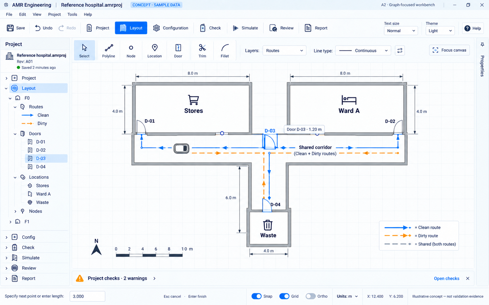
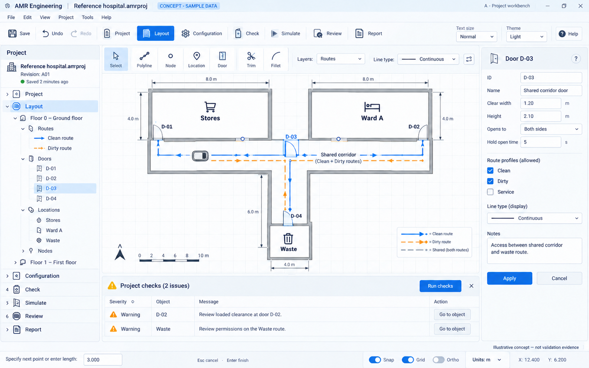
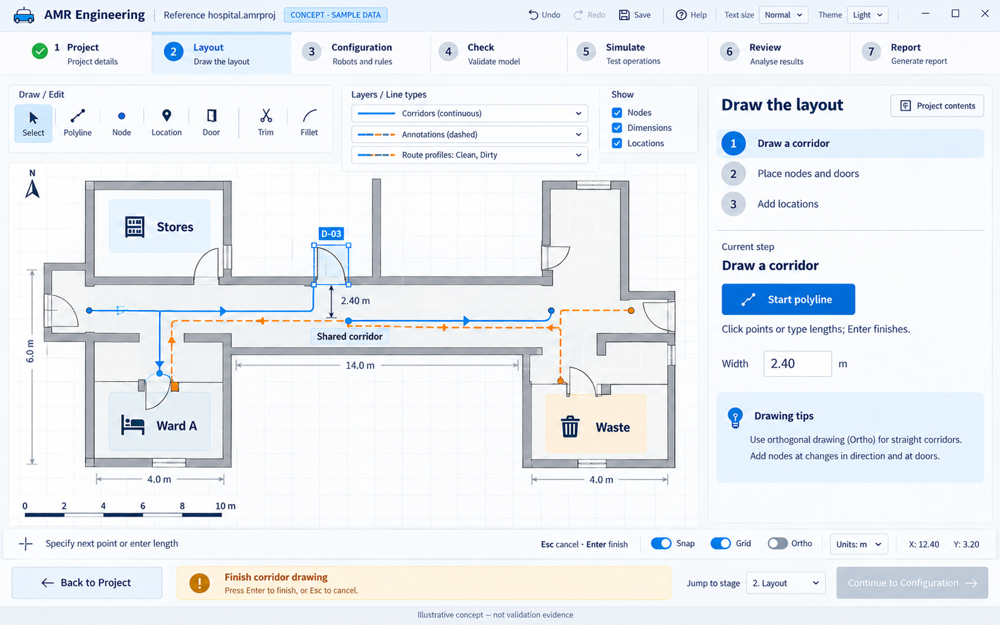
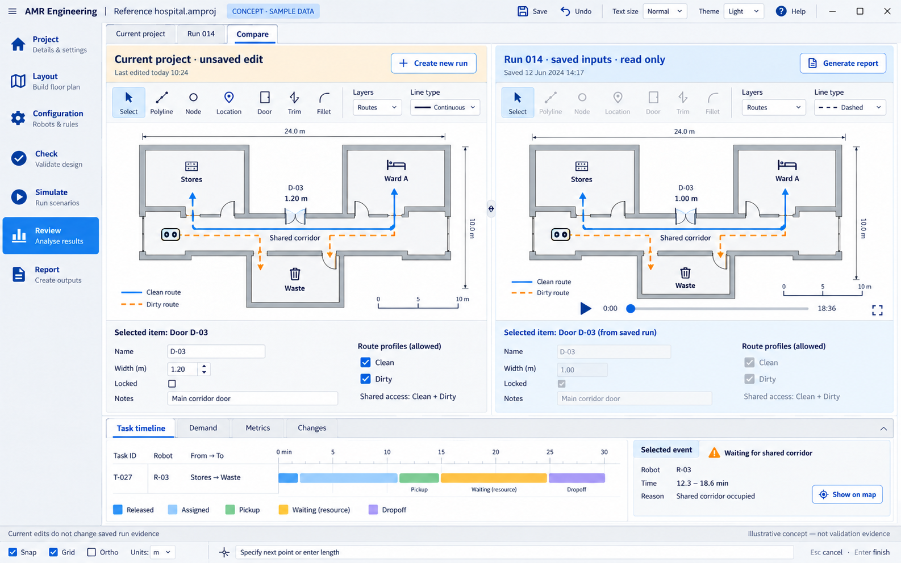
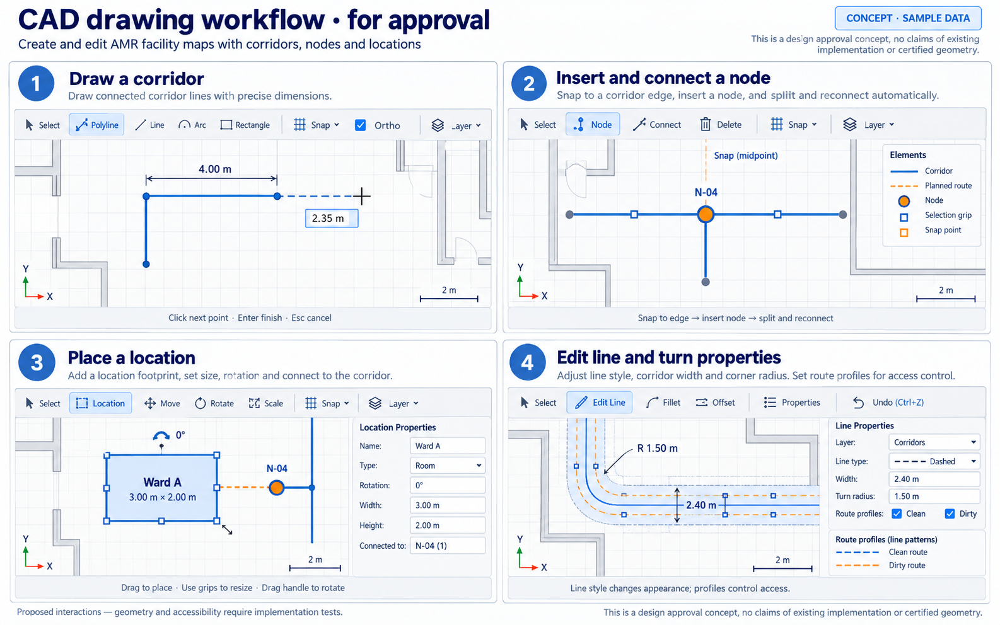

# CAD workbench design review

## Decision recorded — 3 October 2026

The user selected Option A and approved the refined **A2 graph-focused workbench**
with “This looks good”. A2 is the visual direction for the final application.
The graph must occupy the majority of the main window; side and bottom panels
provide additional information without overcrowding it. Common CAD drawing and
editing interactions are required for line elements, nodes and locations.

This approves the visual direction. Detailed gestures, keyboard mappings, panel
behaviour and complete user workflows still need review before production UI
implementation. The images illustrate proposed controls and sample data; they
are not screenshots of working features or engineering validation evidence.

The user subsequently resumed work and prioritised geometric traffic/manoeuvres,
the graph-dominant CAD UI and learning materials. Geometry and runnable workflow
prototypes now proceed ahead of the remaining exhaustive option audit, as recorded
in the [roadmap](../../verification/ROADMAP.md). Production workflow approval and
the full release gates remain required.

The first [runnable geometry workbench](../../verification/GEOMETRY_WORKBENCH_REVIEW.md)
demonstrates route/obstacle drawing, typed coordinates, radius and pivot controls,
loaded-footprint clearance, undo and collapsed supporting panels. It is a separate
planning prototype with an illustrated reference tutorial, not the completed A2
project application. Review its actual interactions before adopting them in the
production editor.

Open the [image gallery](index.html) for a convenient visual comparison.

## Approved visual direction: A2

Use a compact project tree, a large central drawing area and a short CAD toolbar.
Properties are a collapsed side tab and checks a slim bottom summary in the default
drawing view. Expand supporting information when needed. Keep visible routes,
labels, patterns, units, selection feedback and drawing prompts legible.

Proposed workflow: open a project → draw/select on the graph → inspect properties
when needed → open checks and navigate to affected objects → simulate → review
recorded results → report. Panel resizing, remembered state and focus-canvas
behaviour remain to be demonstrated in a prototype.

## Original A: expanded supporting panels

This established the chosen workbench style. It illustrates contextual properties
and checks together, but the expanded panels consume too much graph space for
the default drawing view. A2 supersedes its default panel balance.

## Retained alternatives

### B: guided workspace

A stage bar and task guide lead the user through drawing and configuration.
It offers useful ideas for the later tutorial, but a permanent guide competes
with drawing space. It is not the selected application shell.

### C: comparison workspace

Side-by-side maps compare the current project with a read-only saved run, with
supporting evidence below. This could inform an optional Review layout after
workflow approval; it is too dense for default drawing. Frozen runs must stay
clearly distinct from editable current inputs.

## CAD interactions to demonstrate and approve

- Draw connected corridor polylines quickly, with snapping, dynamic dimensions,
  typed coordinates/lengths/angles, clear units and finish/cancel feedback.
- Insert a node into an existing edge, split and reconnect in one undoable action;
  distinguish intentional junctions from crossings without connections.
- Place and edit labelled location footprints, sizes, rotations and connections.
- Select with clicks and selection windows; edit grips and use meaningful move,
  copy, rotate, trim, extend, offset, split and join commands.
- Control layers, visibility, locking, line types and weights. Display styling
  must not change access: clean/dirty/shared access is defined by route profiles,
  and shared sections belong to the applicable profiles.
- Show widths, radii and swept footprints using verified model geometry. A drawn
  curve or illustrative clearance label does not prove physical feasibility.
- Use consistent zoom, pan, repeat, undo/redo, Esc and Enter behaviour. Approve
  precise shortcuts and mouse mappings through the prototype.

## Remaining workflow review

Review the normal drawing workflow and its cancellation/invalid-input states;
selection and property drafts; bulk edits; save/recovery; stale checks and warning
acknowledgements; simulation progress/cancellation; results investigation; and
reporting. Agree how supporting panels open, close and retain state without
unexpectedly reducing graph space. Check keyboard access, adjustable text and
colours, contrast, route labels/patterns and behaviour on smaller screens.

The final tutorial follows the delivered UI: a compact reference exercise, an LTN
worked example, contextual help and a separate illustrated PDF with editable
source. Use screenshots of the actual approved application for that guide.

## Assets and provenance

Five PNG assets are stored alongside this review. They were generated and refined
with **built-in image_gen**. The [prompt record](prompts.json) preserves generation
and correction prompts and source locations. Historical prompts describe earlier
proposals; this review and the roadmap govern the selected direction. Generated
text, placement and geometry are illustrative and require implementation review.
