# Building flow tutorial

Create, test and improve a three-floor building in Simple mode. Every floor is 40 x 20 m (800 square metres), with a 3.5 m floor height. The two original lifts sit at x=34 and x=38 m, favouring the far end of the plan.

Start from Help > Building flow tutorial. A small bubble highlights the actual control and checks project or frozen run state automatically as you work. Next becomes available after all requested actions pass; use it when ready to continue. The last action also checks the whole chapter. Details shows the full instructions and corrections. Back revisits an earlier action. Show control takes you to its workspace without editing inputs or opening Properties. Pause removes the aids; Help > Building flow tutorial resumes them. Help > Restart tutorial bubble rebuilds the bubble at the current step without resetting your edits or progress.

The bubble avoids the highlighted target, side panes and visible controls. Drag its six-dot grip to move it; a safe position stays put during the current action. More > Reset bubble position returns to automatic placement. New actions and opened editors are placed afresh. With enlarged text, long guidance remains available under More > Show explanation / corrections.

Long actions use grouped checklists in a scrollable bubble. Inside a dialog, the bubble guides the current control and a blue prompt beside the highlighted field gives its required value. The prompt moves to the next incorrect field as you enter each value; it never edits or saves inputs. Hidden fields first highlight their tab. Required values in the main workspace stay in the bubble. Save each editor when its values match.

The bubble is an independent nonmodal instruction dialog owned by the main application. Naming, Save and configuration dialogs cannot destroy it. Its name, floor and coordinate guidance remains visible while you edit; finish or cancel that editor before continuing. Closing or pressing Escape on the bubble does not pause it; use Pause explicitly.

More opens explanations, checkpoints, object rebinding, policy selection, optional lessons and this guide. The larger course window is an optional reference. A checkpoint creates a saved working copy; choose a destination outside the installed example folder. Tutorial progress saves automatically beside that project in .amrproj.tutorial.json as you practise, change chapters and advance actions. Saving the first project or using Save as preserves that progress. Resume restores your position and skips verified chapters and actions to the first unfinished step.

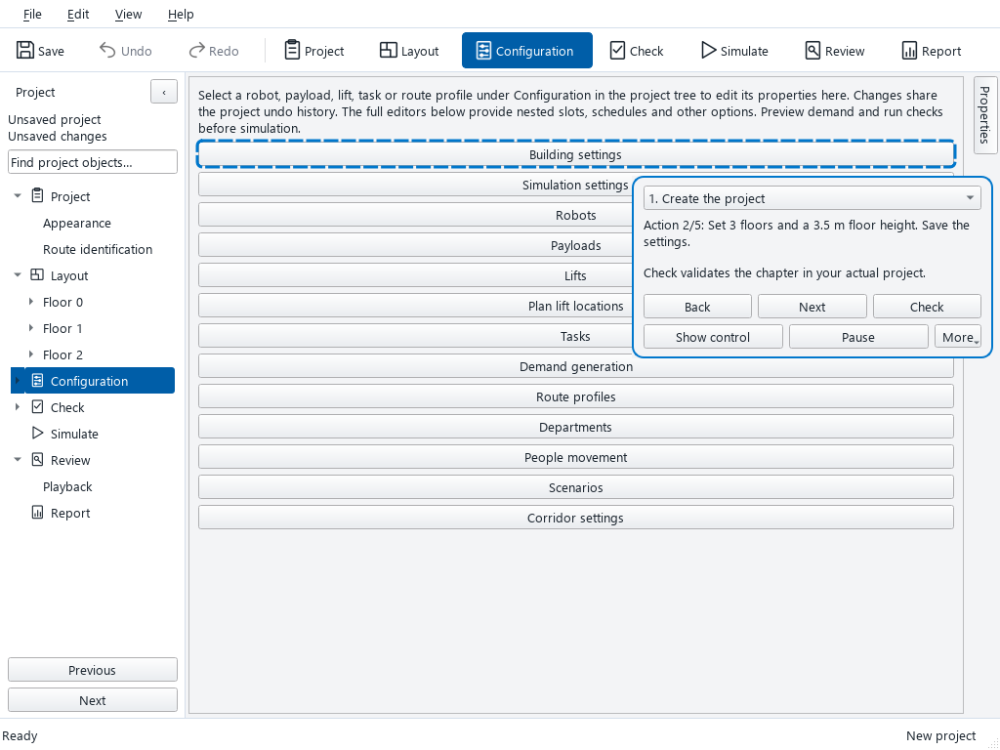

## Get the practice assets

The tracked [floor 0](floor-0.dxf), [floor 1](floor-1.dxf), and
[floor 2](floor-2.dxf) drawings share metre units and origin.
[The side-by-side drawing](building-three-floors.dxf) is for presentation only.
Portable `.amrproj` starter/checkpoint/reference archives mentioned below are
generated assets, not checked-in downloads. A development package may supply them.

With the source dependencies installed, generate a separate teaching folder
from the repository root (create the destination parent folder first):

```powershell
.\.venv\Scripts\python.exe -m amr_tutorial_assets "C:\AMR studies\building-practice"
```

This writes aligned drawings and portable starter, chapter-3 through chapter-7,
and dedicated/shared reference archives under the chosen folder. Open
`starter.amrproj` or use **Help → Building flow tutorial** to create a working
copy/checkpoint. Keep the generated reference input unchanged and save your own
project separately. Reference JSON files retained in the repository may have
machine-specific drawing paths; generate portable assets instead.

## Example files and setup

Use floor-0.dxf, floor-1.dxf and floor-2.dxf for per-floor import; all use metre units and the same origin. building-three-floors.dxf is a side-by-side presentation for sharing, not the per-floor import source. starter.amrproj contains drawings only. chapter-3/4/5/6/7 checkpoints retain progressively more configuration. reference-dedicated.amrproj and reference-shared.amrproj contain the completed designs.

| Item | Teaching configuration |
| --- | --- |
| Circulation | Clean lane y=7; dirty lane y=13. Nodes x=3,8,10,12,18,24,30,34,38 on every floor. Shared transition (3,10). |
| Service endpoints | Floor f: clean (8+2f,4), dirty (8+2f,16); door nodes at y=6 and y=14, 1.2 m clear width. |
| Ground floor | Dispatch (3,10), Clean store (3,7), Dirty receiving (3,13), Wash (5,13). Connect these to the corresponding circulation. |
| Charging bays | Four AMR bays, 1.4 x 1.1 x 2 m, chargers enabled. Local offsets dx=-1/+1, dy=-0.8/+0.8; use each combination once. |
| AMRs | Teaching AMR quantity 4; 1 x 0.7 m; speed 1.5 m/s; payload limit 100 kg and 1.2 x 0.9 x 1.5 m. Motor 96 W, battery 0.1 kWh, initial SOC 15%, charge rate 2 kW, threshold 20%. |
| Payloads | Clean tote and Dirty cart: 0.8 x 0.6 x 1 m, 20 kg, lengthways. |
| Lifts | L1=(34,10), L2=(38,10), all floors. Car 2 x 2 x 2.5 m; speed 0.5 floors/s; door 4 s; boarding 3 s; health decay 0. Shaft 2 x 2 m, landing 1 m, clearance 0.1 m. |
| Building operations | Load/unload 5 s; idle return off; opportunity charging off; initial low SOC demonstrates charging. Dirty receiving requires wash at Wash, 60 s; Wash capacity 1. |

## 1. Create the project

Purpose and expected result: Three aligned 800 m² drawings and a saved project.

1. File > New project, or More > Start from drawings to save a working copy.

2. Open Configuration > Building settings. Set Number of floors to 3 and Level height to 3.5 m, then Save.

3. Choose floor 0, 1 and 2. For each, right-click its tree entry > Add DXF and import its individual drawing.

4. Fit each floor. Confirm 40 x 20 m and alignment at the common origin.

5. File > Save project as. Keep the supplied starter unchanged.

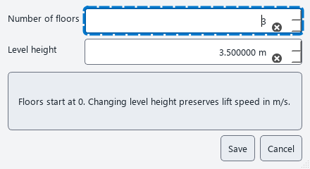

Check: Three aligned 800 m² drawings and a saved project. If it fails, the bubble names the first correction; More > Show explanation / corrections lists the remaining findings.

## 2. Learn the workbench

Purpose and expected result: An actual edit and undo/redo, with the controls used.

1. Switch floors, then return to floor 0.

2. Click Fit to see the whole plan.

3. Use Object snap at the bottom right; use Grid snap in the drawing toolbar. Toggle a snap setting to practise.

4. Select a node. If the drawing has no nodes, use Transition to place one at (3,10) on floor 0. Edit > Move selected by: enter 0.1,0 in Move by (m), then Apply move.

5. Click Properties explicitly, inspect the selected node, then collapse it.

6. Edit > Undo (Ctrl+Z), then Edit > Redo (Ctrl+Y). Undo again to restore the original position. The chapter checks that both actions were used.

Check: An actual edit and undo/redo, with the controls used. If it fails, the bubble names the first correction; More > Show explanation / corrections lists the remaining findings.

## 3. Draw clean and dirty circulation

Purpose and expected result: Connected same-floor lanes and service locations on all floors.

1. Choose floor 0 and Corridor. Follow the numbered clean lane markers at y=7 m from left to right. Keep 2.4 m width and bidirectional travel. Escape finishes the route.

2. Choose floor 0 and Corridor. Follow the numbered dirty lane markers at y=13 m from left to right. Keep 2.4 m width and bidirectional travel. Escape finishes the route.

3. On floor 0, choose Transition and click empty space at (3,10) to create the shared node. Then choose Corridor: click the clean lane at (3,7), the new node at (3,10), and the dirty lane at (3,13). Keep 2.4 m width and bidirectional travel. Escape finishes.

4. Choose Door. Place doors at (8,6) and (8,14). Select each, explicitly open Properties, set Clear door opening to 1.2 m, and Apply changes.

5. Choose Location. Place Clean-F0 at (8,4) and Dirty-F0 at (8,16); enter the shown name at each marker.

6. Choose Corridor. Connect the clean lane through its door to its service location, following the three markers. Escape finishes.

7. Choose Corridor. Connect the dirty lane through its door to its service location, following the three markers. Escape finishes.

8. Choose floor 1 and Corridor. Follow the numbered clean lane markers at y=7 m from left to right. Keep 2.4 m width and bidirectional travel. Escape finishes the route.

9. Choose floor 1 and Corridor. Follow the numbered dirty lane markers at y=13 m from left to right. Keep 2.4 m width and bidirectional travel. Escape finishes the route.

10. On floor 1, choose Transition and click empty space at (3,10) to create the shared node. Then choose Corridor: click the clean lane at (3,7), the new node at (3,10), and the dirty lane at (3,13). Keep 2.4 m width and bidirectional travel. Escape finishes.

11. Choose Door. Place doors at (10,6) and (10,14). Select each, explicitly open Properties, set Clear door opening to 1.2 m, and Apply changes.

12. Choose Location. Place Clean-F1 at (10,4) and Dirty-F1 at (10,16); enter the shown name at each marker.

13. Choose Corridor. Connect the clean lane through its door to its service location, following the three markers. Escape finishes.

14. Choose Corridor. Connect the dirty lane through its door to its service location, following the three markers. Escape finishes.

15. Choose floor 2 and Corridor. Follow the numbered clean lane markers at y=7 m from left to right. Keep 2.4 m width and bidirectional travel. Escape finishes the route.

16. Choose floor 2 and Corridor. Follow the numbered dirty lane markers at y=13 m from left to right. Keep 2.4 m width and bidirectional travel. Escape finishes the route.

17. On floor 2, choose Transition and click empty space at (3,10) to create the shared node. Then choose Corridor: click the clean lane at (3,7), the new node at (3,10), and the dirty lane at (3,13). Keep 2.4 m width and bidirectional travel. Escape finishes.

18. Choose Door. Place doors at (12,6) and (12,14). Select each, explicitly open Properties, set Clear door opening to 1.2 m, and Apply changes.

19. Choose Location. Place Clean-F2 at (12,4) and Dirty-F2 at (12,16); enter the shown name at each marker.

20. Choose Corridor. Connect the clean lane through its door to its service location, following the three markers. Escape finishes.

21. Choose Corridor. Connect the dirty lane through its door to its service location, following the three markers. Escape finishes.

The canvas shows the finished route as a dashed preview and numbers each click. The highlighted marker is the next click; it moves as actual nodes and links are created. Use the normal Corridor, Door and Location tools. Door openings are applied through Properties, which you open explicitly. Each route stays on its indicated floor; no preview changes the project.

Next remains unavailable while a required point, link, door opening or service name is missing or incorrect. Finish a completed route with Escape before continuing. Checks run automatically and show corrections on their actual floor and canvas position; an existing corridor with an incorrect width, direction or length is highlighted for a Properties repair. Renamed service locations retain their bound roles; a deleted role needs repair or rebinding. Undoing an earlier connection blocks progress again. Chapter navigation also checks unfinished work.

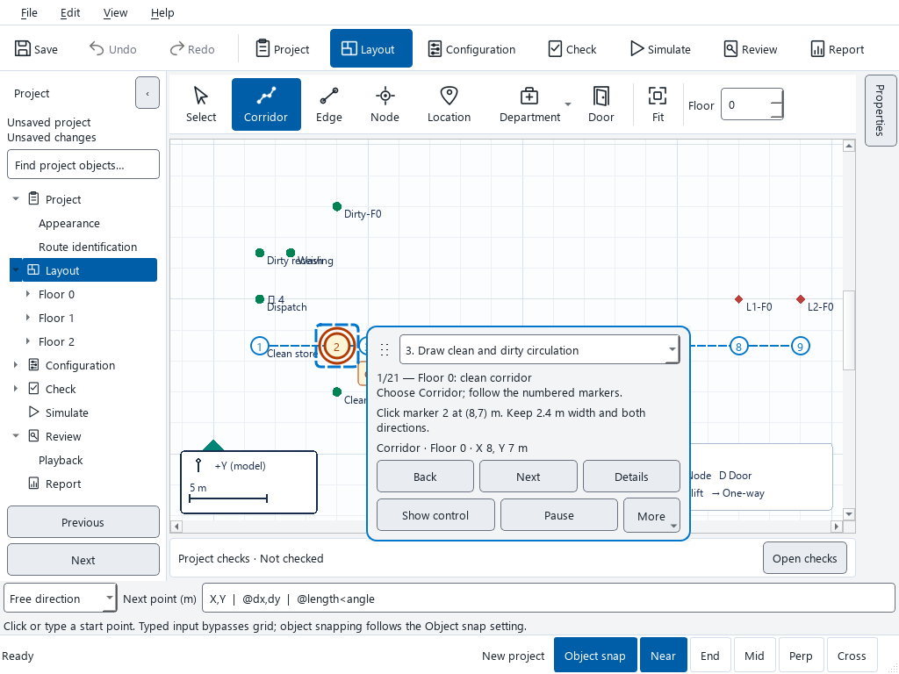

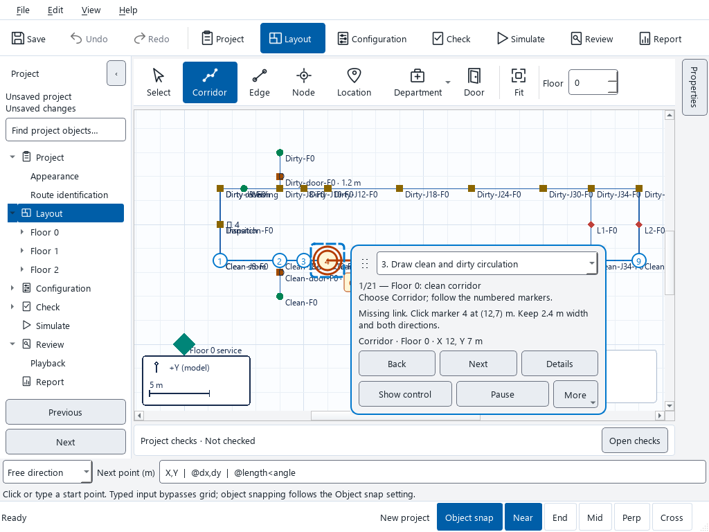

Check: Connected same-floor lanes and service locations on all floors. If it fails, the bubble names the first correction; More > Show explanation / corrections lists the remaining findings.

## 4. Add dispatch, charging and wash facilities

Purpose and expected result: Four compatible charging bays and a reachable wash station.

1. Place the four ground-floor facilities on their numbered markers. Each joins its corridor; enter the shown name, then Save.

2. Select Dispatch > Properties > Create / edit spaces. Alternative: right-click Dispatch > Inventory spaces. Read the bay sizes and dashed position previews, then Create four tutorial charging bays > Save and close. Each bay is 1.4 × 1.1 m with 2 m clear height; centres are (2,9.2), (4,9.2), (2,10.8), (4,10.8). Chargers are enabled.

3. Select Dirty receiving > Properties. Set Wash cycle required to Yes, Wash location to Wash, and Wash duration (s) to 60. Click Apply changes. These fields wash the AMR after delivery.

4. Select Wash > Properties. Enter 1 in Service capacity (AMRs), then click Apply changes. Wash can serve one AMR at a time.

Four ground-floor markers show Dispatch (3,10), Clean store (3,7), Dirty receiving (3,13) and Wash (5,13). Choose Location, click the orange marker and enter the shown name. Save creates the location and its stated 0.1 m corridor access link, splitting a corridor segment if needed. The next missing facility is highlighted automatically. Cancel leaves the project unchanged. A wrong position or removed access link blocks Next and identifies the repair; Undo/Redo includes the placement and access link together.

The same contextual coordinate entry and pointer preview are available for Node, Door, Location, Department, Lift and Edge tools. Coordinates are in metres and use the active floor. Object/grid snapping is shown before insertion; typed X,Y bypasses grid and opens the normal editor. Boundary and rectangle tools retain their existing entries and also show pointer coordinates. Facility, department and lift steps show spatial hints; every other stage highlights its actual control and validates completion automatically.

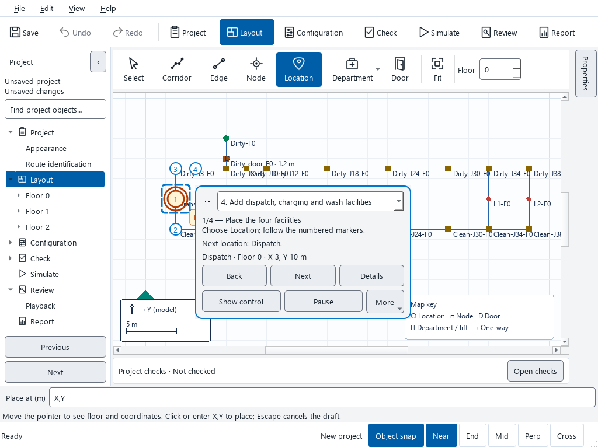

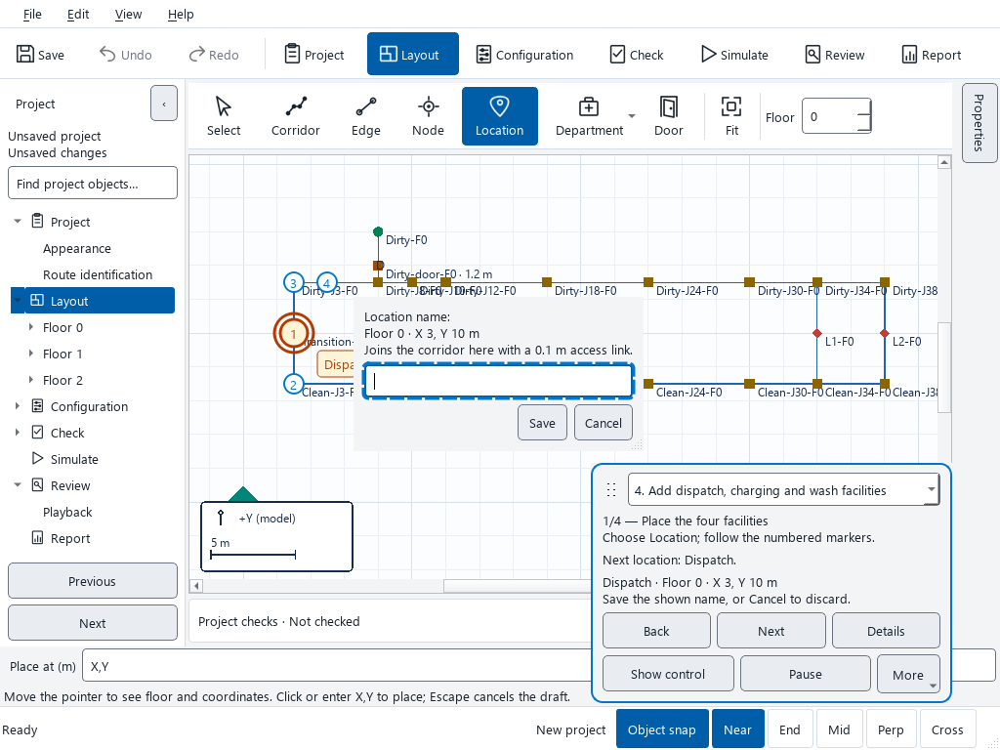

Washing uses the visible location Properties fields. At Dirty receiving set Wash cycle required to Yes, Wash location to Wash, and Wash duration (s) to 60. The bubble highlights each field, then Apply changes. At Wash enter 1 in Service capacity (AMRs) and Apply changes; this is the simulator limit for simultaneous service, including washing. Draft values do not complete these actions until applied.

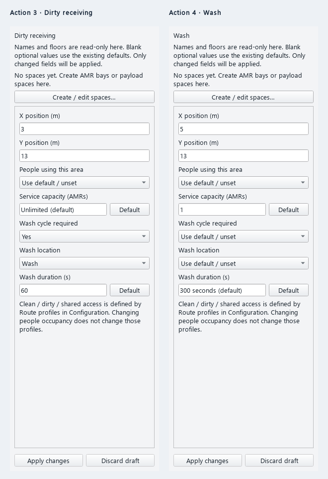

Check: Four compatible charging bays and a reachable wash station. If it fails, the bubble names the first correction; More > Show explanation / corrections lists the remaining findings.

## 5. Configure transport

Purpose and expected result: Four compatible robots, two payloads, departments and two complete lifts.

1. Configuration > Robots > Add.

AMR details
- Name: Teaching AMR
- Fleet quantity: 4
- Overall length: 1 m
- Overall width: 0.7 m
- Normal travel speed: 1.5 m/s
- Travel motor power: 96 W

Battery and charging
- Usable battery capacity: 0.1 kWh
- Charging power: 2 kW
- Request charging at: 20%
- Initial state of charge: 15%

Payload slots > first row > Edit selected
- Weight capacity: 100 kg
- Length / width / height: 1.2 / 0.9 / 1.5 m

Save the slot, Save the AMR type, then Save the AMR list.

2. Configuration > Payloads > Add.

Payload details
- Name: Clean tote
- Overall length: 0.8 m
- Overall width: 0.6 m
- Overall height: 1 m
- Loaded weight: 20 kg
- Lengthways: on; Sideways: off

Save; repeat for Dirty cart, then Save the payload list.

3. Configuration > Departments > Add.

Details
- ID: D0
- Name: Floor 0 service
- Floor: 0
- Enabled: on

Hours & waste
- Operating start: 06:00
- Operating end: 08:00

Task locations & zones
- Stores > Select: Clean-F0
- Linen > Select: Dirty-F0

Save. Repeat D1/Floor 1/Clean-F1/Dirty-F1 and D2/Floor 2/Clean-F2/Dirty-F2, then Save the department list.

4. Configuration > Lifts > Add.

Lift and floors
- Lift name: L1
- Floors served: 0,1,2
- Starting floor: 0
- Vertical travel speed: 1.75 m/s (0.5 floors/s)
- Door operation time: 4 s
- AMR boarding / exit time: 3 s
- Stop table, each floor: X 34 m, Y 10 m

Car and energy
- Clear car length: 2 m
- Clear car width: 2 m
- Clear car height: 2.5 m

Health and reliability
- Health lost per journey: 0

Save. Repeat for L2 with X 38 m, Y 10 m on every floor.

Enter one highlighted value at a time. The blue field prompt follows the next value that differs from the checklist. Unloaded robot weight may remain Unspecified; it is optional report metadata. Payload Loaded weight must be 20 kg for this tutorial.

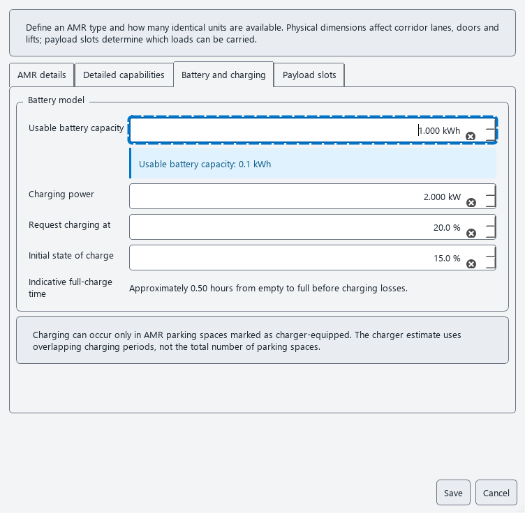

Check: Four compatible robots, two payloads, departments and two complete lifts. If it fails, the bubble names the first correction; More > Show explanation / corrections lists the remaining findings.

The department Floor control is editable in Details. Lift and floors contains an editable stop table: enter X/Y for each served floor. When a requested field is on another tab, the bubble highlights that tab first; it then highlights the field and its required value. Save the nested editor, then the list; the lift list instead applies each saved lift and closes with Close.

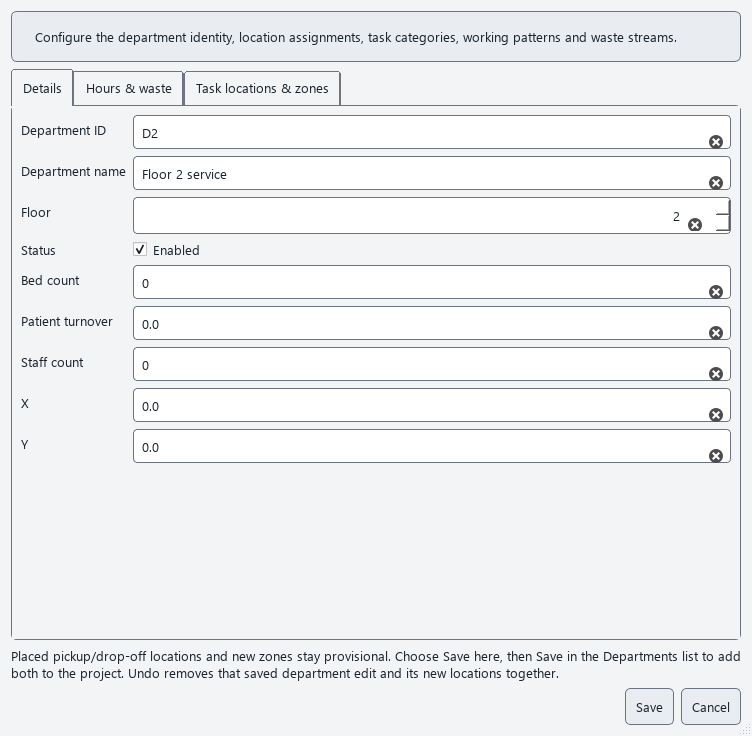

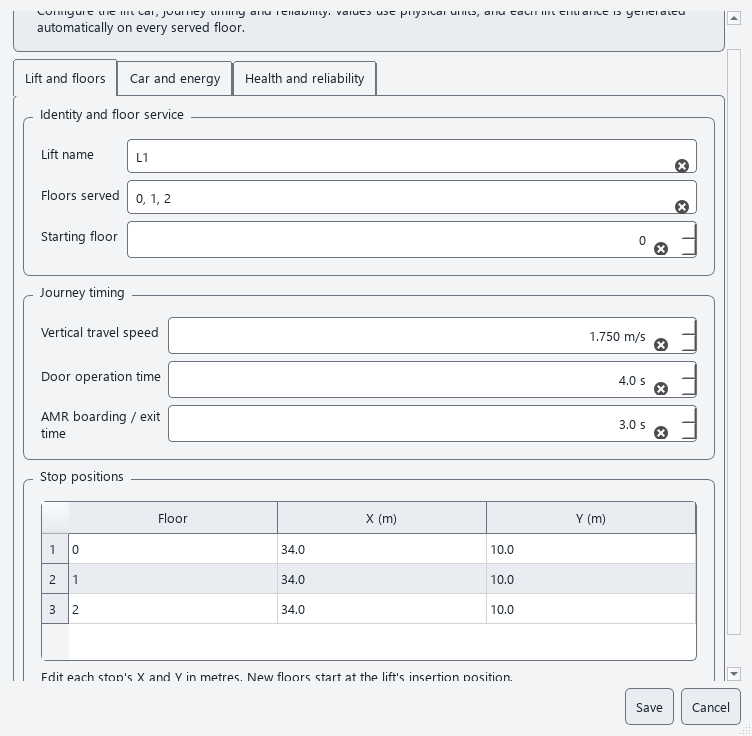

## 6. Define your flow policy

Purpose and expected result: Payload routes obey the chosen permissions. Empty travel uses the existing model.

1. Layout > Route profiles > Add.

Profile attributes — clean
- Profile name: clean
- Allowed nodes: clean lanes and doors, Clean-F0/F1/F2, Clean store and permitted lift stops
- Allowed edges: corridor links between those nodes on floors 0, 1 and 2
- Allowed lifts: L1 for Dedicated; L1 and L2 for Shared

Select nodes and edges in Layout
- Select > Nodes: click each orange-ringed node; blue means selected.
- Change floors using Floor in the route selection toolbar.
- Select > Edges: click each dashed orange corridor link.
- A two-way corridor adds both directions; a one-way corridor keeps its direction.
- Click again to remove an unintended selection.
- Finish selection, then Apply Changes.

Repeat for dirty
- Profile name: dirty
- Allowed nodes: dirty lanes and doors, Dirty-F0/F1/F2, Dirty receiving, Wash and permitted lift stops
- Allowed edges: corridor links between those nodes on every floor
- Allowed lifts: L2 for Dedicated; L1 and L2 for Shared

If geometry is missing, Cancel selection and close the profile editor first. Use Layout > Add node / transition to place a node and Layout > Add edge between nodes to connect two existing nodes. Reopen the profile and continue graphical selection. Save All after applying both profiles.

2. Layout > Route profiles. Select each profile.

Allowed lifts > Pick
- Dedicated: clean uses L1; dirty uses L2.
- Shared: both profiles use L1 and L2.
- Graphical selection must include each permitted lift stop and its corridor access edges on floors 0, 1 and 2.

Apply Changes for each profile, then Save All. In the tutorial More window choose the matching policy.

3. Layout > Route profiles > Save All.

Before continuing
- clean and dirty have their graphical node and edge selections applied.
- Allowed lifts match the policy chosen in More.
- Save All commits both profiles to the project.

A different policy needs a separate comparison study.

In Layout choose Routes on the drawing toolbar, or Layout > Routes, to open Route view. Select clean or dirty. Profile colour changes the permitted-edge colour; Blocked colour changes the dotted excluded directions. Show blocked directions and Show profile labels are independent display switches. Arrows distinguish one-way permission. Profile details lists permitted and blocked directions and lift allowances. Colours save as personal preferences and do not change permissions.

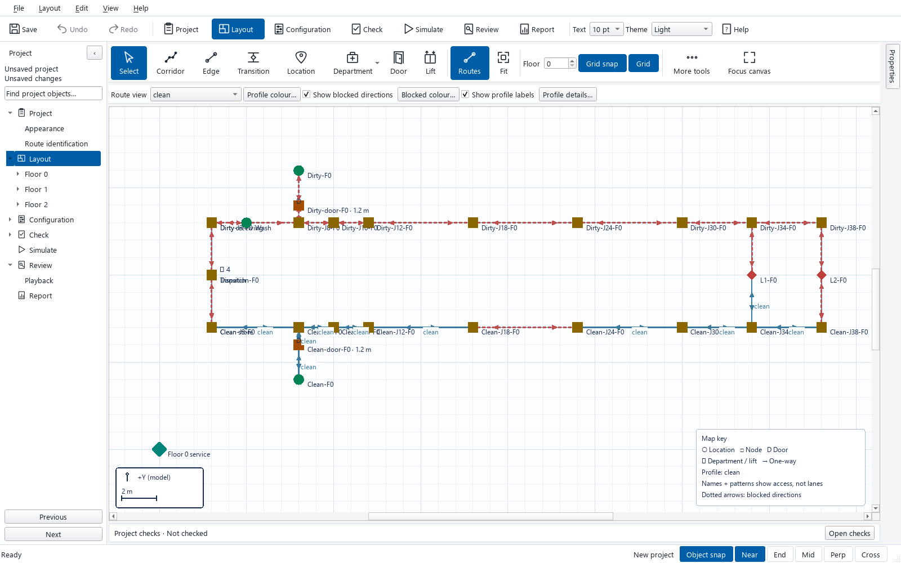

Dedicated profiles permit only the matching lane/service nodes and their designated lift stops (L1 for clean, L2 for dirty). Shared profiles retain lane permissions but include both sets of lift stops and both lift IDs. Dispatch and shared transition areas remain available to empty AMR travel under the existing model. Changing the course policy describes your chosen inputs; it does not configure routes for you.

Layout has Add node / transition, Add edge between nodes and Route profiles. The profile editor offers Select nodes and edges in Layout. Its dedicated toolbar keeps Floor, Nodes / Edges, selection counts, Finish selection and Cancel selection visible while you use the existing drawing.

Orange rings and dashed links show the permissions required by the selected tutorial policy; blue marks selected permissions. Guidance follows each missing node, then each directed edge, across floors. Overlapping nodes and zero-length access links offer a choice of names. Changing floors retains previous selections. Finish selection returns a draft to the profile editor; Apply Changes and Save All commit it. Cancel selection retains the previous draft.

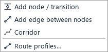

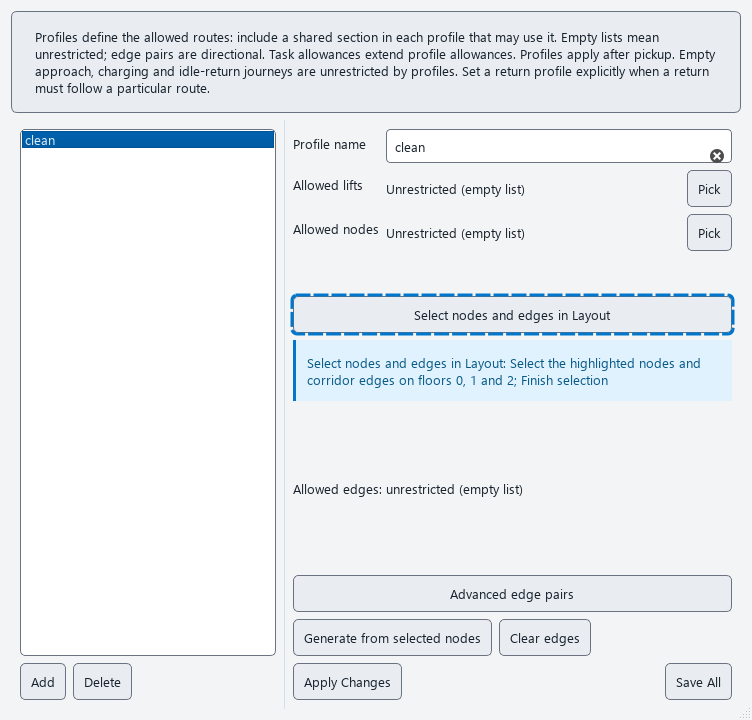

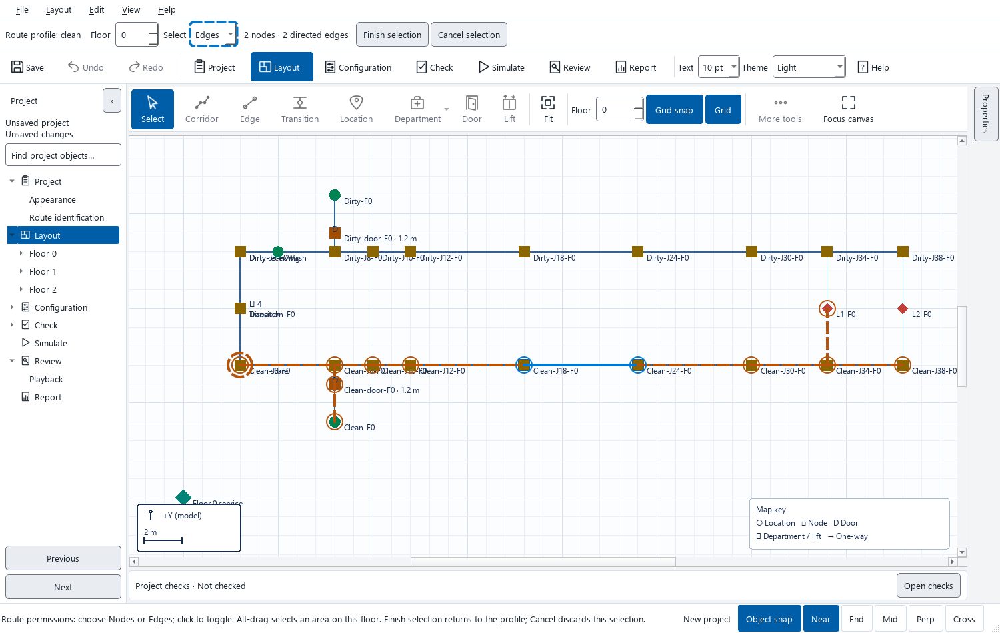

Check: Payload routes obey the chosen permissions. Empty travel uses the existing model. If it fails, the bubble names the first correction; More > Show explanation / corrections lists the remaining findings.

## 7. Generate deliveries and collections

Purpose and expected result: Deterministic work serving all floors, both flows and return work.

1. Configuration > Demand generation. Enable automatic task generation. Select Stores, then each department D0/D1/D2.

Basics
- Enabled: on
- Generation mode: scheduled
- Service target (s): 600

Locations & routing
- Department locations: drop-off
- Pickup / source location: Clean store
- Payload: Clean tote
- Route profile: clean

Schedule & staff
- Staff handling: off

Repeat for Linen
- Department locations: pickup/source
- Drop-off destinations > Select: Dirty receiving
- Payload: Dirty cart
- Route profile: dirty

Save.

2. In Demand generation configure each Stores and Linen department D0/D1/D2.

Basics
- Service target (s): 600

Schedule & staff > Scheduled times > Edit times
- 06:05
- 06:35
- 07:05
- 07:35
- Click OK after adding all four times.

Returns & stock — Stores
- Generate return / exchange task: on
- Return payload: Clean tote
- Return route profile: clean
- Return delay (minutes): 2

Keep Linen returns off. Save. Department actions > Configure multiple is an alternative for shared settings.

3. Open Check and click Demand preview beside Run checks. Then click Build preview.

Review the planned work
- Departments: D0, D1 and D2
- Flows: Stores / clean and Linen / dirty
- Planned releases: 06:05, 06:35, 07:05 and 07:35
- Stores returns: after 2 minutes (generated during simulation)

Use Tasks, Timetable and Rules and reconciliation to inspect the preview before running.

Check: Deterministic work serving all floors, both flows and return work. If it fails, the bubble names the first correction; More > Show explanation / corrections lists the remaining findings.

Stores scopes: D0,D1,D2 with Clean store pickup and Clean-Ff drop-off. Linen scopes: Dirty-Ff pickup and Dirty receiving drop-off. Each department operates 06:00-08:00. Four Monday release times create 24 outbound tasks; clean returns add 12 tasks. Use 5 January 2026, 06:00-08:00, Simple. Completed normal reference runs have 36 completed, 0 failed and 0 pending, with both lifts, charging and 12 AMR wash cycles.

Category labels retain Stores and Linen even if the saved flow names are Clean and Dirty. Basics has Service target (s): enter 600 for each department or configured group. Returns & stock has Return route profile: choose clean for Stores. Department actions > Configure multiple exposes these same values for shared group settings. Schedule & staff > Edit times uses Add time for each HH:MM value, then OK. The tutorial validates effective saved department/group settings, rather than requiring hidden category defaults.

For Linen, Locations & routing must use department locations as pickup/source before Drop-off destinations > Select is enabled. The bubble highlights that prerequisite first, then Select, Dirty receiving and OK. For Stores use department locations as drop-off and choose Clean store as pickup.

In the Check pane, Demand preview sits beside Run checks. Click it, then Build preview; the bubble follows both buttons. Review Tasks, Timetable and Rules and reconciliation for D0, D1 and D2 and both clean and dirty routes. Planned deliveries and collections appear in the preview; the clean returns are runtime-dependent work created during simulation.

Run checks also evaluates Task routes: every explicit task and each possible pickup/drop-off pair in active resolved demand rules, including return routes. It honours profile node, directed-edge and lift permissions and manual task extensions. Blocked results identify the affected task or rule, department, profile and leg. Counts describe route definitions, including conditional work; they do not predict release totals. Edit permissions or geometry in Layout, then rerun checks. Clearance, capacity, outages and timing require simulation.

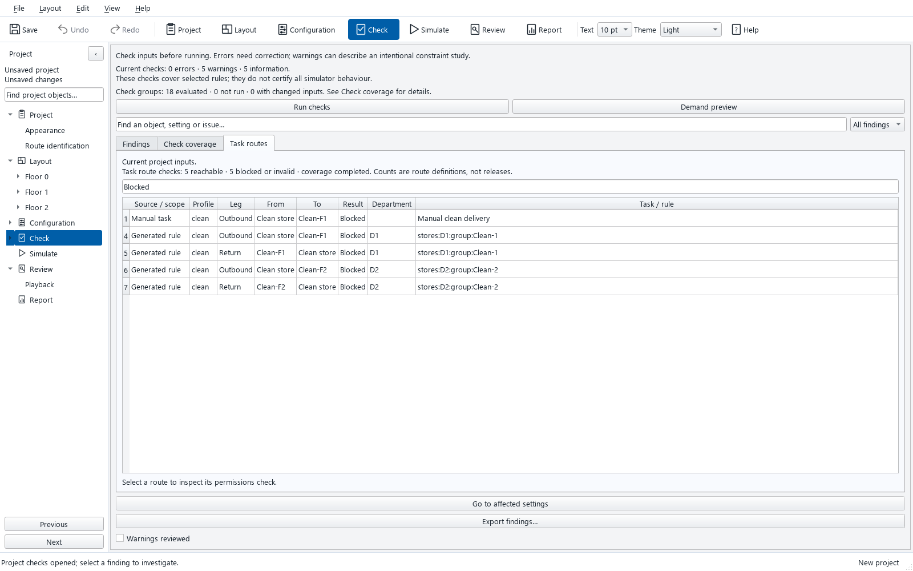

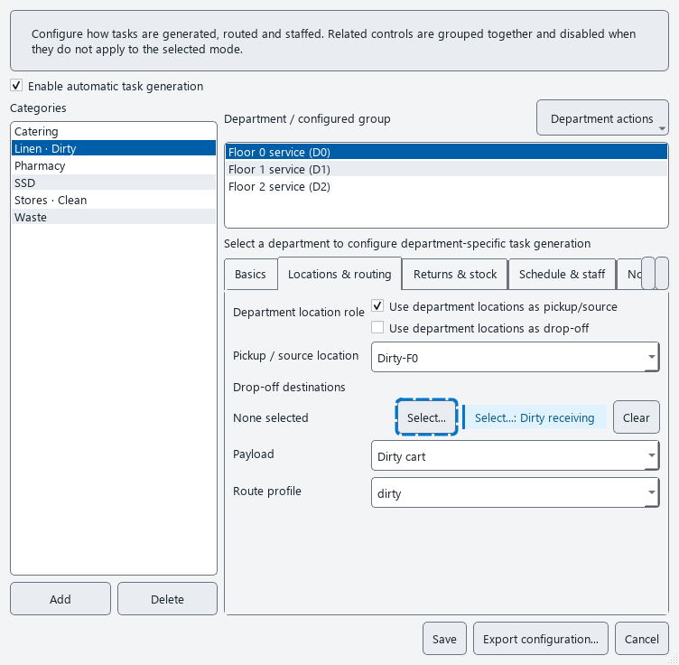

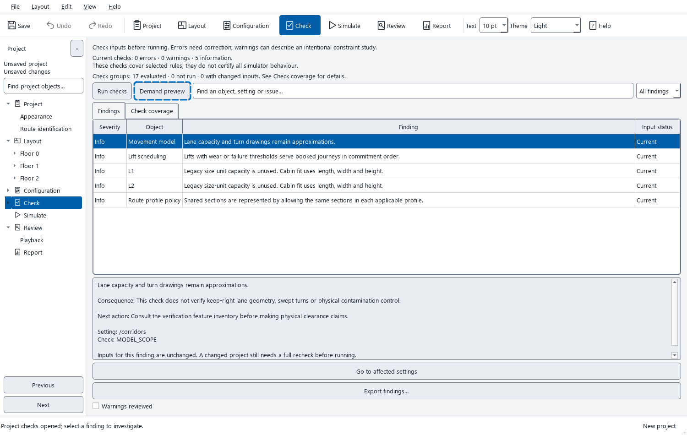

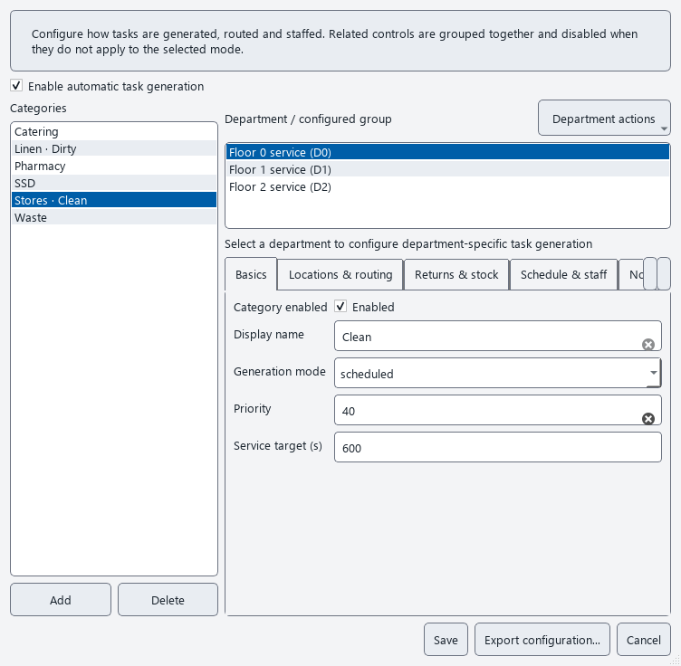

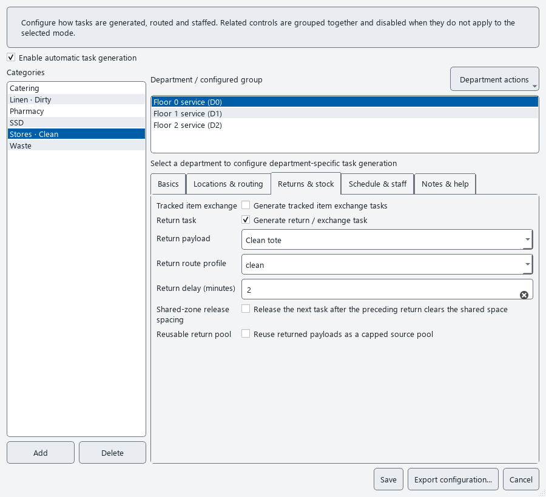

## 8. Check, save and run Simple

Purpose and expected result: A completed frozen Simple run linked to this project.

1. Configuration > Simulation settings. Choose Simple. On Run period set Starts to 5 January 2026 06:00, enable End generated demand at a fixed date and time, and set Ends to 5 January 2026 08:00. Save.

2. Check > Run checks. Select a finding and follow its repair control. Rerun Run checks after applying each repair.

3. Use Save, check and simulate. Inspect progress and wait for a retained completed run.

Check: A completed frozen Simple run linked to this project. If it fails, the bubble names the first correction; More > Show explanation / corrections lists the remaining findings.

## 9. Investigate and play back

Purpose and expected result: Verified evidence includes both lifts, payload transitions, charging and washing.

1. Select the completed run, then Investigate selected run.

2. Select a task and inspect its linked payload, journey and lift evidence.

3. Simulate > select the completed run > Playback selected run. In Playback follow both lifts, AMR charging and post-delivery wash cycles.

Check: Verified evidence includes both lifts, payload transitions, charging and washing. If it fails, the bubble names the first correction; More > Show explanation / corrections lists the remaining findings.

Review > Route checks reruns task navigation against the saved run input snapshot, independently of current project edits. The table shows reachable, blocked or invalid routes and their source settings. Unverified logs without an input snapshot have no route coverage; current project inputs are never substituted. These are static permission checks, not proof that recorded movements physically completed.

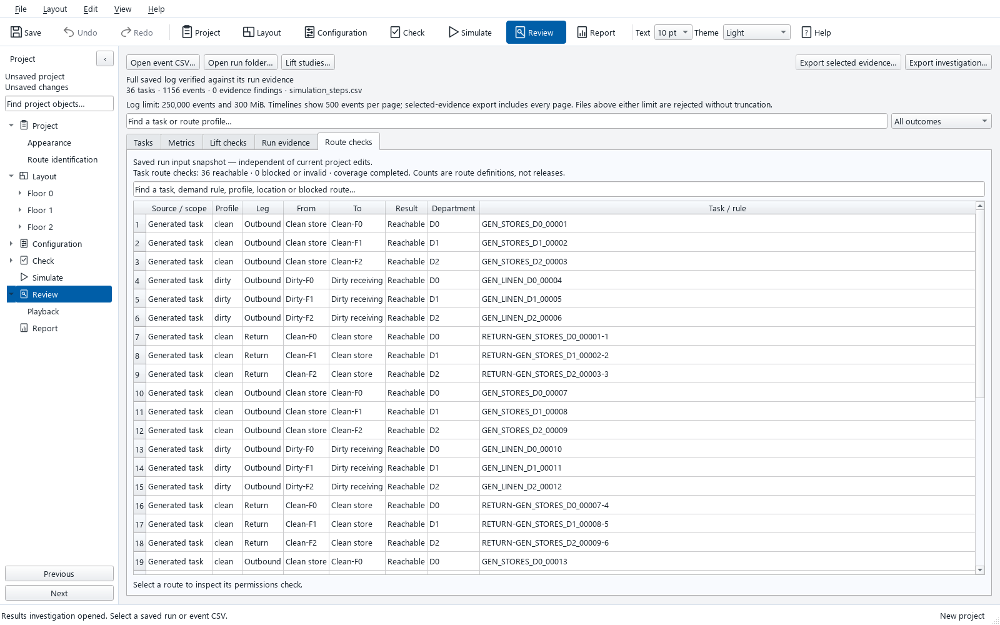

Washing services the AMR after a designated delivery. Payload decontamination and contamination during every empty movement are not simulated. Use the linked payload transition evidence to follow loaded transport; do not infer contamination state from it.

## 10. Stress the design

Purpose and expected result: Baseline scenario evidence identifies distance, lift, wash and charging constraints.

1. Open lift planning. Infer drawings, assign layer roles and review each floor overlay.

2. Confirm units, boundary, circulation, exclusions and floor registration. Evaluation requires confirmation.

3. Evaluate the baseline scenario suite. Read completed/failed/pending and on-time service for every floor and flow.

Check: Baseline scenario evidence identifies distance, lift, wash and charging constraints. If it fails, the bubble names the first correction; More > Show explanation / corrections lists the remaining findings.

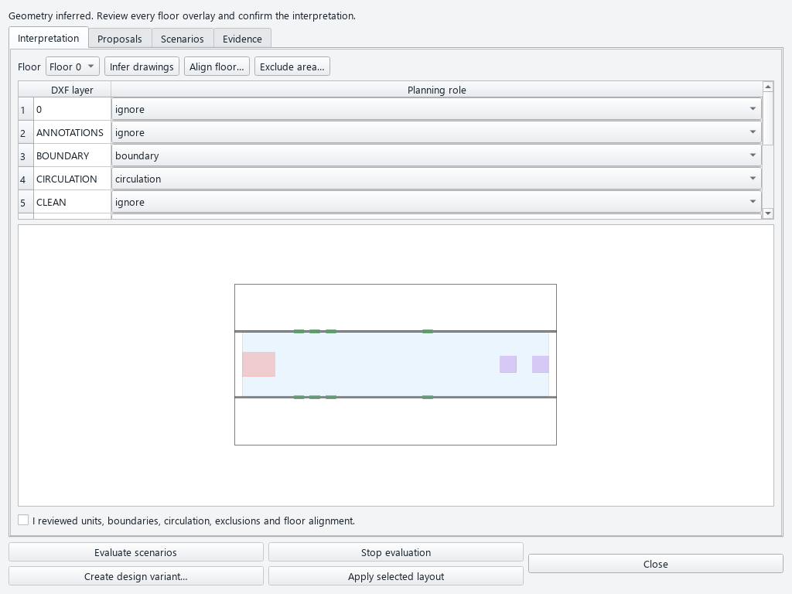

## 11. Improve lift locations

Purpose and expected result: A completed comparison and a safely saved improved variant, or an explained absence of improvement.

1. Plan lift locations > Proposals.

Proposal settings
- Shaft length: 2 m
- Shaft width: 2 m
- Landing depth: 1 m
- Clearance: 0.1 m
- Move L1 and Move L2: on

Click Generate five layout proposals, select each proposal and inspect Proposal overlay floor on all floors.

2. Evaluate all proposals against identical frozen schedules. Read the service guard before distance changes.

3. Plan lift locations > Proposals. Select a result that passes the Service guard, then click Create design variant and choose a separate project file.

Check: A completed comparison and a safely saved improved variant, or an explained absence of improvement. If it fails, the bubble names the first correction; More > Show explanation / corrections lists the remaining findings.

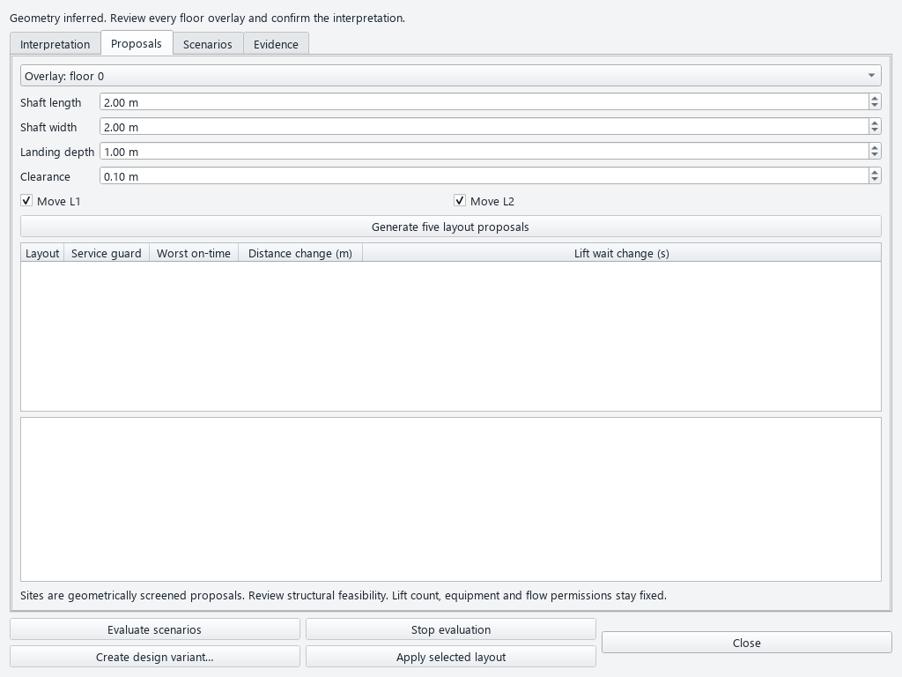

## 12. Report and hand over

Purpose and expected result: Readable exports, reopened project and retained original run evidence.

1. Select a frozen run and choose Report selected run.

2. Choose sections, then Generate report. Read the PDF and lift CSV.

3. Plan lift locations > Evidence. Click Export comparison CSV and save it, then Export comparison PDF and save it. Both exports include the service guard and tradeoffs.

4. Save and reopen your project. Retain baseline, variant, tutorial companion, study companion and run folders.

Check: Readable exports, reopened project and retained original run evidence. If it fails, the bubble names the first correction; More > Show explanation / corrections lists the remaining findings.

## Comparisons, evidence and portability

Review and confirm a closed building boundary, circulation, wall openings, retained facilities and prohibited areas on every floor. Ambiguous/open boundaries or absent circulation need repair; the drawing bounding box is never treated as the building boundary. Metre and millimetre drawings, transformed blocks and supported curves are flattened with maximum 10 mm deviation. Layer roles and registered offsets/rotation are saved in the study.

A 1 m grid screens aligned shaft/landing footprints; 0.25 m paths connect permitted circulation. The eight-site shortlist uses demand-weighted directed graph distances. Five non-overlapping two-lift proposals retain equipment, identities, demand and flow permissions. Structural feasibility requires user review. Inspect every proposed connector and floor before applying a layout.

The suite includes normal, twice-volume peak, L1 outage, L2 outage, one lift at half speed, a 15-minute important-corridor closure, reduced charging and slow washing. Outage/slow events run from 5 to 20 minutes after the start. Charging and washing are separate variants. Each layout replays the same recorded baseline arrivals, including return requests captured from the initial reference run. Returns are then independent frozen requests; layouts do not regenerate return arrival times. Requests without a service target receive the study 10-minute target.

Only complete, reconciled and comparable results can rank. Protect every department floor/flow on-time rate and completed volume relative to current layout, then rank by worst floor/flow service, horizontal distance and lift wait. Horizontal loaded/empty movement is distinct from vertical lift travel. Outage reachability is topological access during the event; task evidence shows waiting and subsequent service. Dedicated permissions can prohibit backup access; relocation alone cannot remove that constraint or add capacity.

Create design variant saves a separate .amrproj by default. Apply selected layout is an explicit undoable change and invalidates current checks, while historical run evidence stays frozen. Changed project inputs, drawing bytes or software mark a study stale. Stop evaluation retains finished runs; reevaluate resumes verified finished runs and retries incomplete work. Locate moved run accepts matching registered evidence only.

Retain the project, its .tutorial.json and .lift-study.json companions, and the referenced study/run folders together. Project drawings are embedded portably. Companion records contain registered paths; use moved-run relinking after moving run folders. PDF/CSV comparison exports are convenient summaries; the study records and immutable run evidence explain them.

## Verified example improvement

Dedicated: proposal-1; worst floor/flow on-time 75.0%; suite horizontal change -17728.4 m; lift-wait change -4017.3 s. Every floor/flow passed its baseline service guard. These are deterministic example results, not a claim for another drawing or policy.

Shared: proposal-2; worst floor/flow on-time 75.0%; suite horizontal change -17049.0 m; lift-wait change 226.0 s. Every floor/flow passed its baseline service guard. These are deterministic example results, not a claim for another drawing or policy.

## Additional lessons

### Advanced demand (configuration)

Demand modes, dates, recurrence, scope groups, stock pools and zero-work explanations. Use Demand preview to verify each change.

### Inventory and exchanges (layout)

Create payload bays; constrain payloads and AMR bays separately. Test stock exhaustion, tracked items, return pools and wait-for-space.

### Staff and people (configuration)

Configure staff response/handling, shifts and working hours; preview a people-flow profile and compare a busy interval.

### Batching and route restrictions (configuration)

Configure slots and multi-stop operation, then investigate shared legs and verify every onboard payload restriction.

### Drawing tools and layers (layout)

Practise Corridor, junctions, doors, copy/move/rotate, bounds, floor drawings, PDF underlays, model locks, DXF visibility and export.

### Appearance and keyboard (project)

Try themes, enlarged text, Focus canvas, panel proportions and keyboard selection. These preferences do not change simulation inputs.

### Recovery and run outcomes (simulate)

Recover unsaved work; cancel a run; inspect failed and pending work. Preserve frozen inputs and understand stale checks.

### Relinking and evidence (review)

Move a copied run folder, use Locate moved run, compare identities and export all selected evidence pages.

### Report options (report)

Explore report sections, lift CSV, title, drawing heatmaps and insertion into an existing PDF.

### Detailed and historical settings (configuration)

Read mode readiness and historical-value explanations. This course operates in Simple; Detailed engineering is a separate activity.

Use More > Complete interface reference for the full inventory of workspaces, commands, dialogs and labelled controls. It maps each to a main lesson, optional lesson or contextual reference, including compatibility windows. Detailed development and LTN tests/workloads are excluded from this increment.
