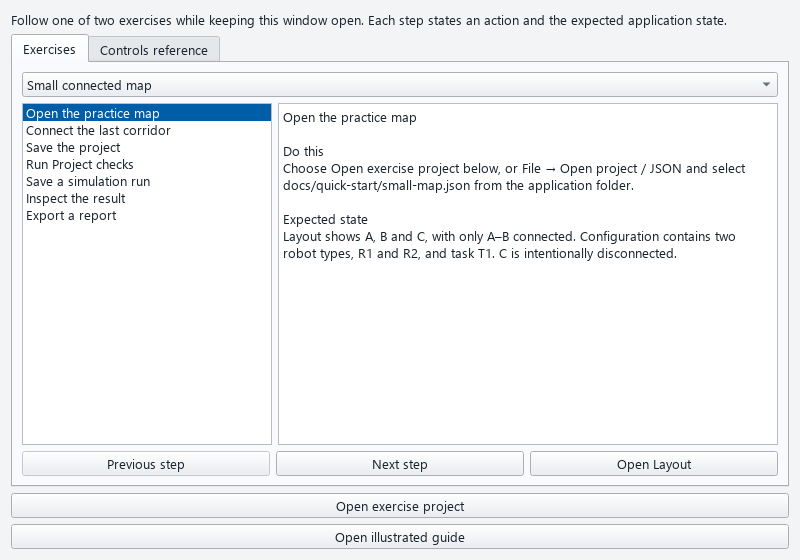
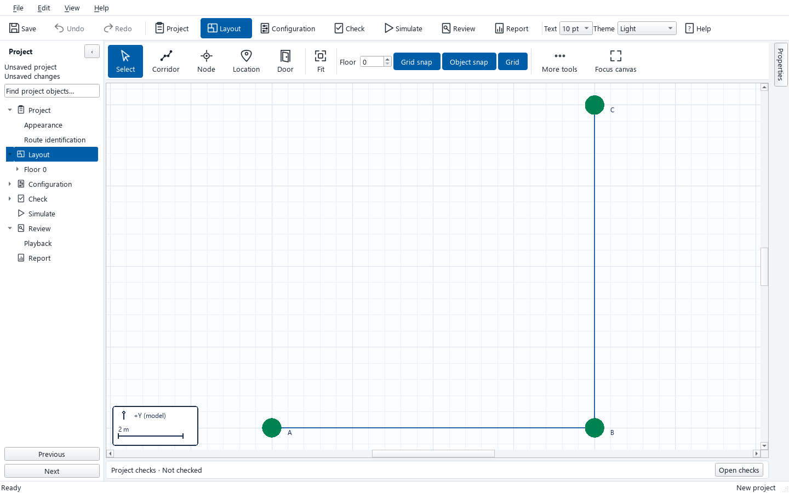
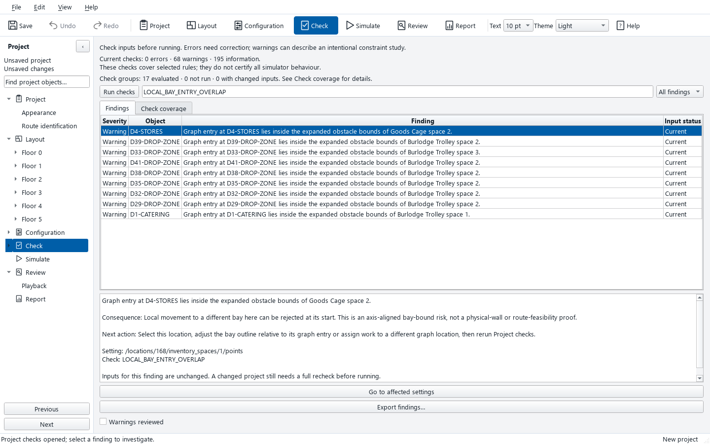
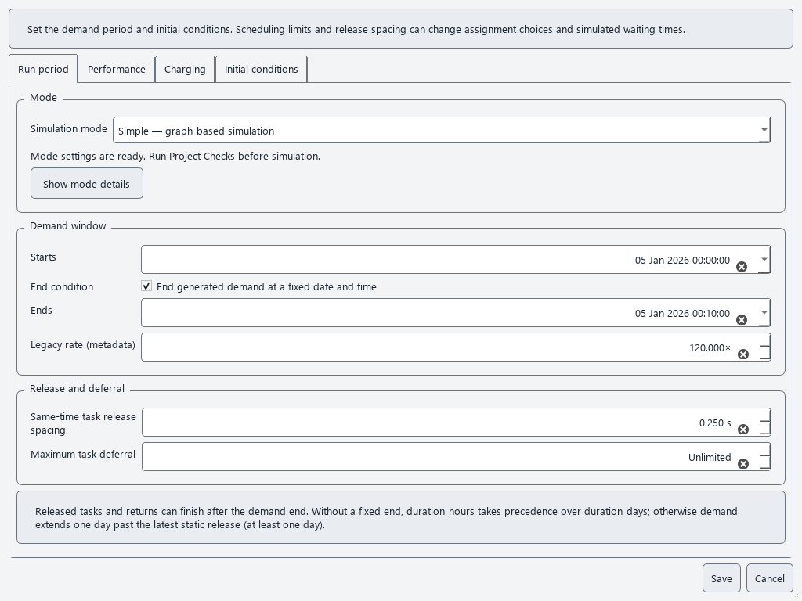

# AMR Simulator Quick Start Guide

Use this guide beside the AMR Simulator workbench. Complete the small-map exercise first, then inspect the supplied LTN project. Help > Guided walkthrough presents the same steps inside the application. Each exercise ends with a saved run, investigated result and report export.

The walkthrough stays open while you use the workbench.

## Exercise 1 Small connected map

### 1 Open the practice map

**Do this:** Choose Open exercise project below, or File → Open project / JSON and select docs/quick-start/small-map.json from the application folder.

**Expected state:** Layout shows A, B and C, with only A–B connected. Configuration contains two robot types, R1 and R2, and task T1. C is intentionally disconnected.

### 2 Connect the last corridor

**Do this:** In Layout choose Corridor. Click B, then C, using endpoint snapping. Press blank Enter to finish the drawing command.

**Expected state:** The graph has A–B and B–C. The new section is one undoable edit. Escape before the second point cancels the uncommitted segment.

The connected small map in Layout.

### 3 Save the project

**Do this:** Choose File → Save project as and save small-map.amrproj in a folder you can find again.

**Expected state:** The title shows the .amrproj file. Reopen it later to confirm the B–C connection and both robot types.

### 4 Run Project checks

**Do this:** Open Check and choose Run checks. Review the findings; use Go to affected settings for any issue.

**Expected state:** The unreachable-task warning from the starting map is gone. This fixture has no check errors or warnings after B–C is connected; informational model-scope notes remain.

### 5 Save a simulation run

**Do this:** Open Simulate and choose Save, check and simulate. Review the checks dialog and start the run.

**Expected state:** A completed run appears in the project’s run list and is saved in its external results folder. The reference input has one completed task, zero failed and zero pending.

### 6 Inspect the result

**Do this:** Select that run and choose Investigate selected run. Search for task T1 and open its supporting events; Playback selected run shows the recorded path.

**Expected state:** Review shows T1 as completed, with its task timeline and linked event rows. The saved run uses frozen inputs even if the editable project changes later.

### 7 Export a report

**Do this:** Return to Simulate, select the run and choose Report selected run. In Report select sections and choose Generate report.

**Expected state:** The report is saved under that run’s reports folder. Open generated PDF views it; the run’s CSV evidence remains alongside the saved run.

## Exercise 2 Supplied LTN project

### 1 Open LTN

**Do this:** Choose Open exercise project below, or File → Open project / JSON and select the supplied LTN project.

**Expected state:** Layout shows the hospital graph and its floors. If you opened JSON, save it as .amrproj before running so the inputs and available drawings are captured.

### 2 Choose a bounded run window

**Do this:** In Configuration → Simulation settings choose Simple and set the end of the supplied 1 January 2026 start day to 11:00. Keep other inputs unchanged, then save the project.

**Expected state:** The configured window is 05:00–11:00 on 1 January 2026. This bounded exercise avoids waiting for the full multi-day LTN run.

### 3 Review checks and layout risk

**Do this:** Open Check, choose Run checks, and search for LOCAL_BAY_ENTRY_OVERLAP. Select a finding and choose Go to affected settings. Review all warnings before acknowledging them.

**Expected state:** Project checks navigate to affected drop-off locations, including D29, D32, D33, D35, D38, D39 and D41 in the supplied input. These are bay-bound risks, not proof that every task fails.

LTN bay-entry warnings in Project checks.

### 4 Save the bounded run

**Do this:** Open Simulate and choose Save, check and simulate. Confirm the checked inputs and start the run; do not edit the project while it runs.

**Expected state:** The run appears in the saved run list when the process finishes. Its configuration, checks and event log are frozen in the external results folder.

### 5 Investigate outcomes

**Do this:** Select the saved run and choose Investigate selected run. Filter by outcome or task, then follow its task, journey, payload and lift records.

**Expected state:** Review distinguishes completed, failed and pending-at-stop work. A six-hour run of the supplied portable LTN archive recorded 206 completed, zero failed and zero pending; edited inputs or other software revisions may differ.

### 6 Export the LTN report

**Do this:** Return to Simulate, choose Report selected run, select report sections and choose Generate report.

**Expected state:** A PDF and supporting run CSV records are available under the selected run’s external folder. Report uses the frozen run, not current editable inputs.

## Controls reference

Run period groups related controls; Show mode details reveals full diagnostics.

### Compact settings

Task generation keeps categories on the left and department/group actions above focused settings tabs. Department settings use Details, Hours & waste, and Task locations & zones; Save there, then Save in the Departments list. Simulation settings keep four tabs; Run period groups Mode, Demand window, and Release and deferral. Show mode details reveals the complete findings. New projects and the small-map exercise use Simple mode.

### Project checks

Run checks after editing. Errors need correction; acknowledge only warnings you have reviewed. Go to affected settings navigates current findings. An edit makes the prior review stale.

### Demand preview

Configuration → Demand preview lets you choose dates and filters, inspect generated tasks and the weekly timetable, and read zero-work explanations before running.

### Snaps and selection

The Layout toolbar selects grid and object snaps. Left-to-right windows enclose objects; right-to-left windows touch them. Shift or Ctrl changes a selection. Selection does not open Properties automatically.

### Undo and layers

Use Undo/Redo for graph edits. View → Model layers controls assignment, visibility, locks and drawing style. Route permissions are separate. View → DXF layers changes imported underlay visibility only.

### Run investigation

Simulate lists revision-bound runs. Investigate selected run filters tasks and links timelines to event evidence. Select a task, then use the timeline choice to follow its recorded payload, journey or lift identity across the run. Pending at stop is a recorded snapshot, not a failed task. Timelines page 500 events at a time; Export selected evidence includes every page of the chosen task, related identity, metric or lift check. Logs above 250,000 events or 300 MiB are rejected without truncation.

### Report export

Select a completed run in Simulate, choose Report selected run, select sections, then Generate report. Open generated PDF and find supporting CSV records under the run’s external folder.

## Reading the outcomes

The small-map completion count is a reference for the supplied practice input after B-C is connected. The LTN counts describe a six-hour run of the supplied portable archive. Different project inputs or software revisions can produce different outcomes; use Review to inspect the run you actually saved.
