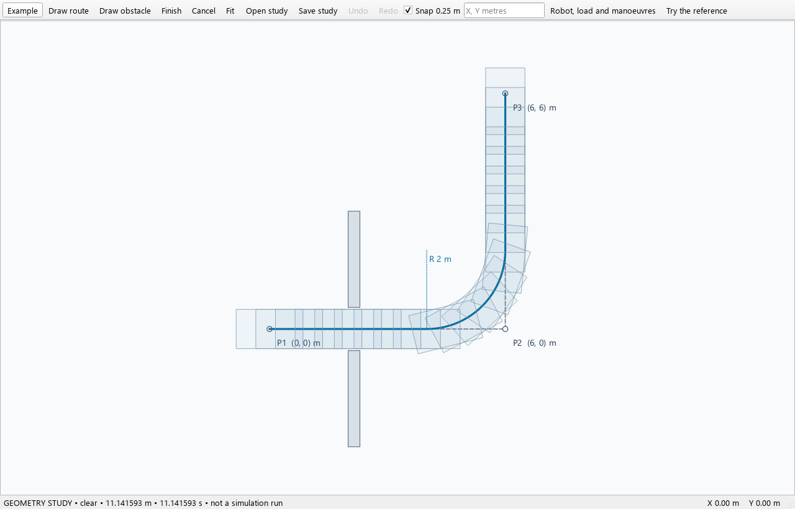
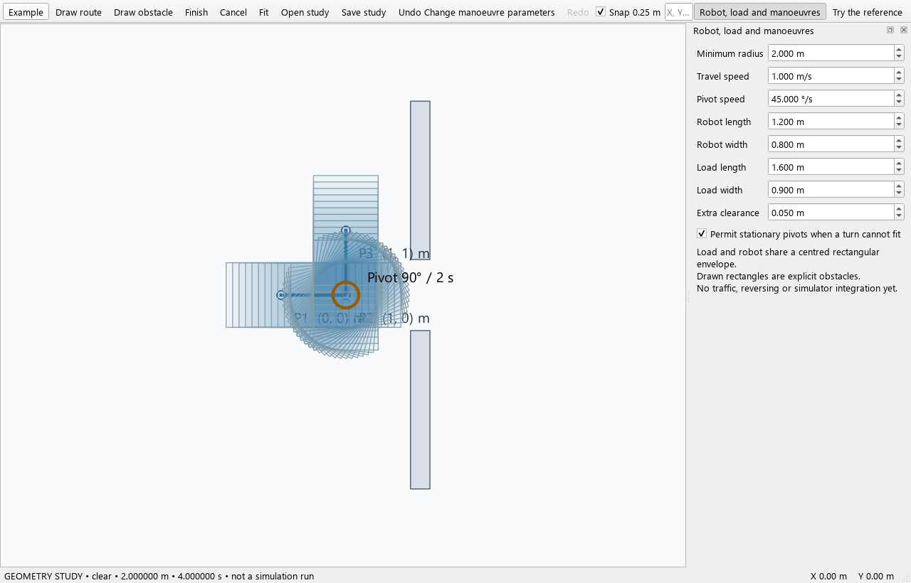

# Geometry and movement

## Detailed mode in a simulation project

The current workbench offers Simple and Detailed mode. In **Configuration →
Simulation settings**, choosing Detailed selects geometric motion and the
keep-right traffic model. It changes the structural contract, not your measured
robot parameters. Use **Show mode details** and current Project checks to find
the remaining inputs.

Detailed requires explicit per-robot initial placements, movement schema 2 with
complete empty/loaded settings, and manoeuvring reference offsets, timing
reference and pivot axis, including zero offsets where appropriate. Supply
separate wall and robot clearances through robot overrides or project defaults.
Required physical geometry and loaded compatibility still need validation.

Do not reuse Simple results as proof of Detailed clearance. Retain the mode,
engineering measurements, geometry and software revision with each frozen run.
Historical geometric configurations without an explicit mode are read through
compatibility rules; those rules do not silently supply missing Detailed inputs.

## Separate geometry workbench

For a focused manoeuvre study, launch this source tool from the repository root:

```powershell
.\.venv\Scripts\python.exe -m visualiser.geometry_workbench
```

This tool saves a separate geometry-study JSON. Opening the tool does not change
your main project or enable Detailed mode. Earlier prototype guides describe
their original checkpoint; use the current source and controls for current studies.



## Check the reference

1. Choose **Example**. The route is (0,0) → (6,0) → (6,6), with 2 m minimum
   radius and 1 m/s speed. Two 4 m straights plus a quarter circle give
   **8 + π = 11.141593 m**, and the same seconds at that constant speed.
2. Open **Robot, load and manoeuvres**. The reference opening is 1.10 m wide.
   A 0.90 m load and 0.05 m clearance on each side need 1.00 m. Increasing the
   load width to 1.01 m needs 1.11 m and should report collision.
3. Use **Draw route** and enter `0,0`, `1,0`, `1,1`, pressing Enter after each
   coordinate, then **Finish**. A 2 m radius cannot fit on the 1 m legs; expect
   `infeasible_route`.
4. Permit stationary pivots with 45 degrees/s angular speed. The 90-degree pivot
   takes 2 s; two metres at 1 m/s add 2 s: **4 s total**.
5. **Save study**, reopen it and check that evidence is recomputed. Infeasible
   studies can be saved for investigation.

**Export simulation** creates a separate geometric JSON project with one delivery,
explicit physical floor bounds, and 2-second pickup/dropoff. Open that JSON in the
main workbench, review Project checks and simulate it as a separate study. The
reference constant-speed route with handling finishes at **15.141593 s**.
Exporting does not change the geometry study or silently turn it into a Detailed
project with every required engineering input.



Wheel zooms, inspection dragging pans, and **Fit** restores the full view.
**Draw obstacle** uses opposite rectangle corners. Shift constrains drawing;
the reference grid snap is 0.25 m. Escape cancels the draft. Completed route,
obstacle and parameter edits support Undo/Redo.

## Interpret the result

`collision`, `infeasible_route`, unresolved clearance and search-budget limits
are different outcomes. An unresolved or exhausted search does not mean clear.
An infeasible requested route does not prove that every alternative is impossible.

The visible footprints illustrate the configured model; checking only displayed
samples is not continuous clearance evidence. Supply real dimensions, reference
points and obstacles, and keep the tool's model limits with your conclusion.
This study is not structural approval, infection-control approval or certification
of a real robot's manoeuvring capability.
