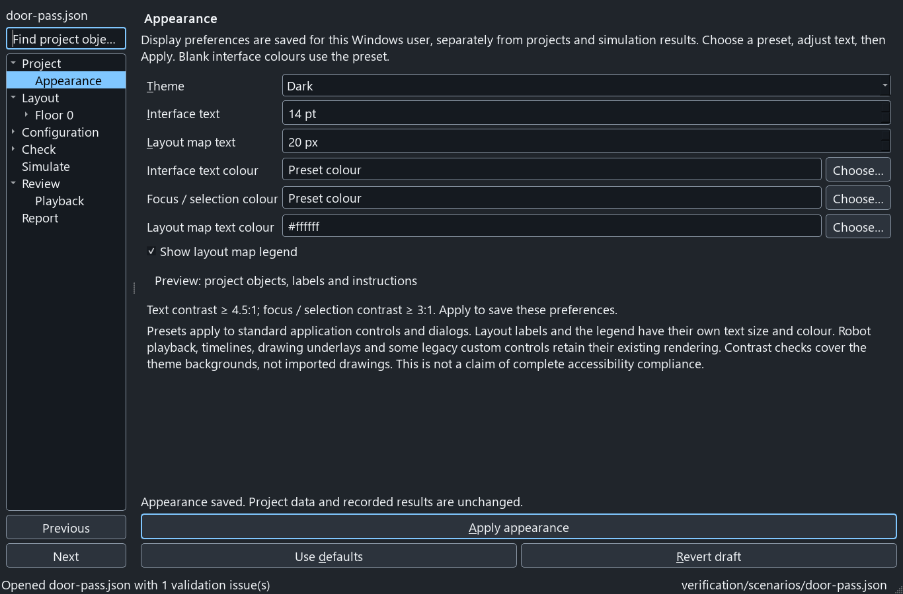
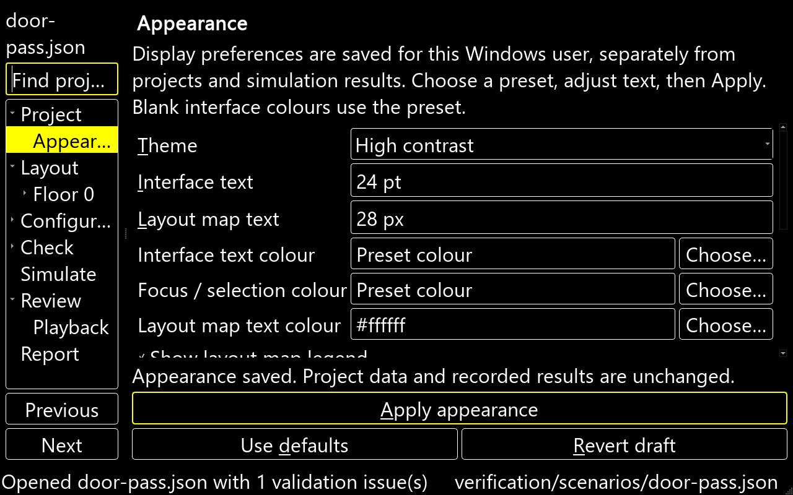
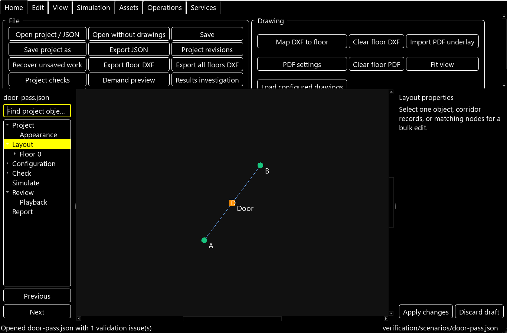

# Appearance — review checkpoint

Open **Project → Appearance** in the persistent project tree. Display preferences
are separate from project configuration, revision history and frozen run inputs.
The desktop launcher saves them for the current Windows user through Qt's INI
settings store (`AMR Engineering / Desktop`, key `appearance/v1`). Tests use
temporary files and do not change your preferences.

## Try the settings

1. Choose **Light**, **Dark** or **High contrast**, then **Apply appearance**.
   Choosing a preset clears custom interface text and accent colours in the draft.
2. Change interface text from **8–24 pt** and layout map text from **10–28 px**.
   The preview changes before applying; the application changes when you apply.
3. Enter a colour as `#RRGGBB` or use **Choose…**. Leave interface text/accent
   fields blank to inherit the preset. Map text requires an explicit colour.
4. Try white interface text in the Light preset. Apply is disabled with a
   contrast explanation. **Revert draft** restores the current applied settings.
5. Enlarge map text, return to Layout, and inspect point labels and the legend.
   **Show layout map legend** can be cleared to free drawing space. Oversized
   legend text is explicitly shortened; hovering over the map shows its full text.
6. **Use defaults** changes the draft; Apply saves it. Restart the normal desktop
   application to check persistence. Project checks and project revision history
   should remain unchanged by appearance changes.

## Behaviour and verification

The standard application controls use a shared Fusion style and palette. Changing
the application palette and font also refreshes Qt's stylesheet caches, so existing
controls receive the changes. Open standard dialogs and subsequently created
controls inherit the settings. The form scrolls; its apply/reset controls remain
available with enlarged text. Workflow navigation buttons are stacked vertically.

Custom active text must have a relative-luminance contrast ratio of at least
**4.5:1** against all four preset backgrounds. Accent colours require **3:1**;
selection text automatically uses black or white for the greater contrast. Map
text is checked against the dark map/legend backgrounds. Black against white is
independently checked at **21:1**; `#777777` against white is approximately
**4.4781:1**, below the text threshold. These are engineering acceptance targets,
not a certification or a claim of complete accessibility compliance.

`tests/test_appearance.py` contains 18 acceptance cases covering reference
contrast values, preset/custom validation, temporary-file round trips, corrupt
settings fallback, failed writes, live styled dialogs, read-only project effects,
pending property drafts, map labels, reset/revert, colour-picker cancellation,
keyboard operation and large-text desktop sizing. Corrupt saved settings are left
untouched until Apply; a notice explains the fallback. A failed settings write
leaves the active appearance unchanged and reports the error.

Actual application screens were inspected at 1366 × 900 and 1280 × 800. Display
changes were exercised on LTN with drawing underlays disabled. The measurement
is in `latest/appearance-ui-review.json`; it is an observation rather than a
performance threshold. This checkpoint does not change simulator algorithms.

## Remaining scope

Playback map labels, timelines, imported drawings and some legacy custom controls
retain their existing rendering. Contrast over arbitrary drawing underlays is not
guaranteed. Full keyboard/screen-reader coverage, all legacy dialogs, route-profile
labels/patterns/colour preferences and verified geometric traffic remain open.
Clean, dirty and shared access continues to be defined by route profiles.
