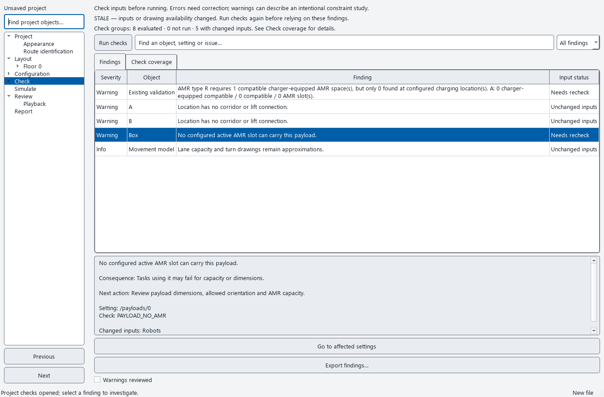
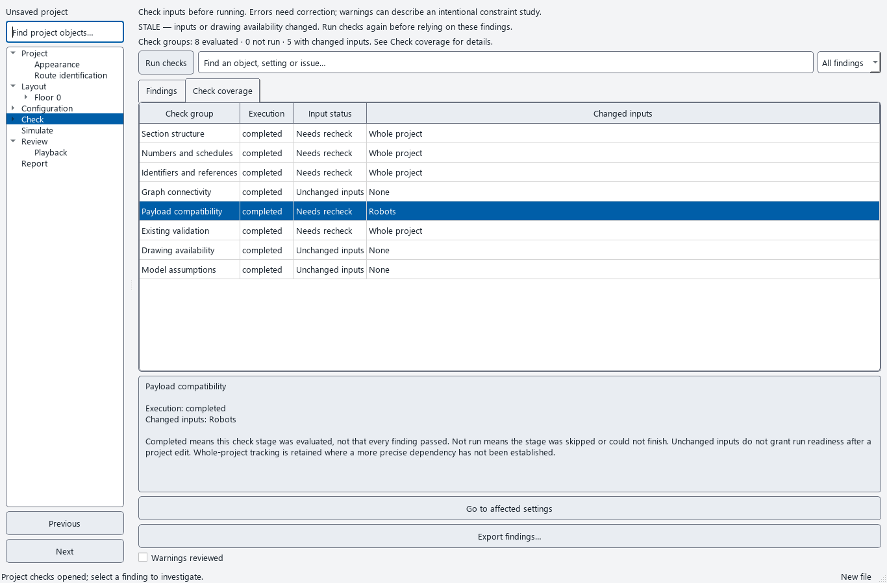
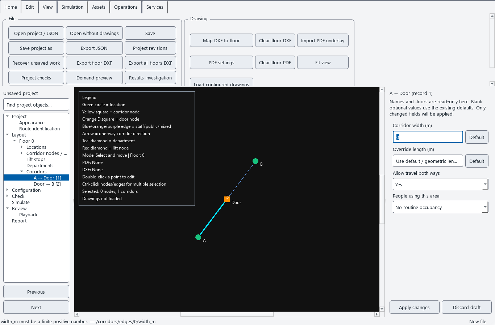

# Project checks — navigation and input currency

The Check workspace now distinguishes findings whose inputs changed from findings
whose inputs are unchanged. Its **Check coverage** tab also tracks evaluated and
skipped check groups, including groups that produced no findings.

This does not make a changed project ready to run. Any configuration change, a
change in referenced drawing availability, or a different project folder still
requires a full recheck. Warning acknowledgements are cleared when the workspace
observes stale checks. Errors continue to block a run.

## Review the workflow

1. Run project checks. Use **Findings** to filter by severity, object or setting.
   Each row now has an **Input status** column.
2. Change a robot setting and return to the existing Check page through the tree.
   The overall report becomes stale. Graph findings can retain **Unchanged inputs**;
   robot/payload compatibility and broader checks show **Needs recheck**.
3. Open **Check coverage**. It shows whether each stage was evaluated, whether its
   inputs changed, and which inputs changed. **Completed** means evaluated; it does
   not mean every input passed. **Not run** means skipped or unable to finish.
4. Select an unchanged finding and choose **Go to affected settings**. A finding
   whose dependent inputs changed cannot navigate using old array indices.
5. Run checks again, review the resulting warnings, and acknowledge them before
   an exploratory run. No subset of unchanged findings bypasses the full-run gate.

## Precise navigation

Findings with identifiable paths select the exact corridor record, location,
corridor/door node, lift stop, robot, payload, static task or route profile. Common
editable fields receive focus and scroll into view. Parallel corridor records and
duplicate robot IDs are resolved using their recorded array indices. Profile names
containing slashes use their recorded identity.

Property drafts remain pinned to their original object. Navigating to a different
finding does not apply or discard a draft. Apply or discard that draft before
editing the newly selected object. Fields absent from contextual properties still
require the full editor. Ambiguous graph identifiers are not guessed; repair them
before selecting the object on the map. Legacy findings without precise paths
retain section-level navigation.

## Recorded evidence and conservative scope

Reports retain their existing finding IDs and schema-1 fields. Additive dependency
metadata records the check groups, executed stages, input hashes and referenced
drawing availability. New runs freeze that metadata alongside findings and warning
acknowledgements. Older records remain readable; absent dependency metadata falls
back to whole-configuration currency.

Known graph checks depend on layout, lift, task and profile inputs as appropriate;
payload compatibility depends on robots and payloads. Reference checks use broader
dependencies. Structural, recursive and legacy checks conservatively track the
whole configuration. These dependencies do not imply complete option validation.

Drawing checks track whether a referenced path is a file, which is the property
the availability check evaluates. They do not validate drawing contents or detect
every content change. Relative paths also depend on the project folder. Existing
run evidence remains a frozen historical record; live file changes do not rewrite it.

## Defects and acceptance evidence

- **D054:** an edge finding could navigate to its start node. A cross-floor finding
  for edge record 1 previously selected `Door` with no edge selected. It now opens
  edge record 1's properties. Exact-width navigation has a reproducing UI test.
- **D055:** creating a previously missing drawing left checks current because the
  JSON was unchanged. Availability changes now invalidate the report and relevant
  check group. Removing an available drawing is also covered.

The recorded before/after probe uses the methods from baseline commit `c0b1411`:
`baseline/check-navigation-and-drawing-before-fix.txt`. No simulator algorithm or
calculated result changes in this checkpoint.

`tests/test_check_workflow.py` adds 26 acceptance cases for selective dependencies,
passing/skipped check groups, legacy fallback, metadata stability, drawing changes,
exact navigation, duplicate identifiers, stale indices, draft preservation,
unavailable inputs, changed project folders, coverage explanations and 24 pt sizing.
The launcher acceptance test also verifies dependency metadata reaches the frozen
run evidence.

Actual screens were inspected at 1366 × 900 and large-text sizing at 1280 × 800.
LTN check and status-refresh measurements are in `latest/check-workflow-ui-review.json`.
These are local measurements, not acceptance thresholds. Complete schema/option
coverage, effective generation-rule checks, all legacy navigation and physical
traffic verification remain open.
