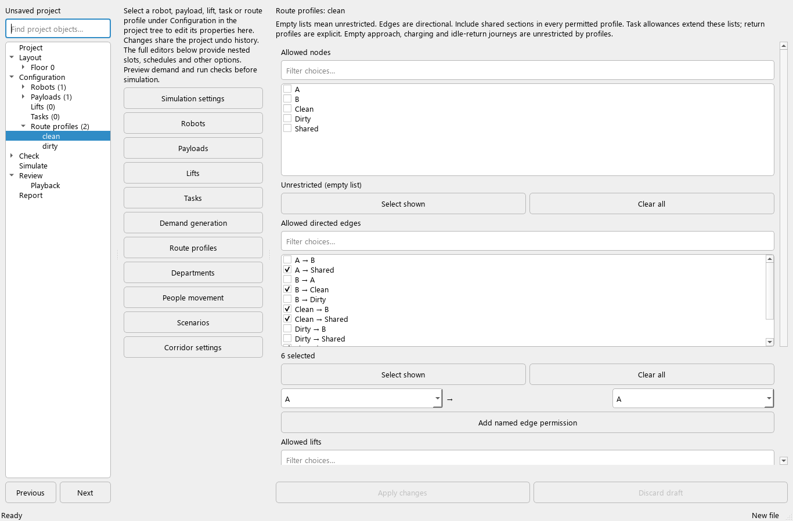
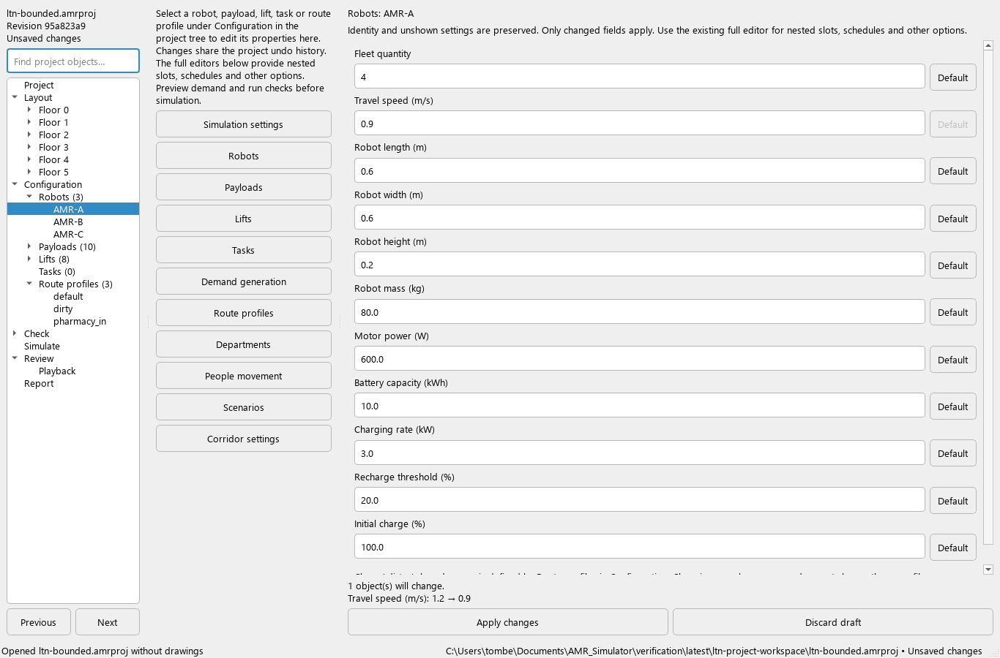

# Configuration objects — review checkpoint

The project tree now lists configured robots, payloads, lifts, static tasks and
route profiles under **Configuration**. Select an entry to edit common properties
in the main window. The form expands to use the available space; the existing
full editors remain beside it for nested and advanced settings.

## Try the workspace

1. Expand **Configuration → Robots** and select a robot type. Change travel speed
   or fleet quantity, inspect the preview, and choose **Apply changes**.
2. Use **Undo** and **Redo**. The complete configuration is restored, including
   nested payload-slot settings and fields not shown in the new form.
3. Select a payload to edit its physical envelope or carrying orientations.
   Select a static task to choose existing pickup/dropoff locations, payload and
   delivery/return route profiles.
4. Select **Route profiles → clean** or the equivalent profile in your project.
   Filter the node, directed-edge and lift lists. Check individual permissions;
   **Select shown** affects the filtered choices, while **Clear all** clears the
   entire list, including hidden choices.
5. Use **Add named edge permission** to allow a directed pair of existing graph
   nodes, including an implicit connection. This adds an allowance only; it does
   not draw or create a physical corridor. Run project checks to assess connectivity.
6. Apply the changes, preview demand and run project checks before simulating.
   Previously saved runs and their playback inputs remain unchanged.

## Editing scope

| Object | Common fields now available in the workspace |
| --- | --- |
| Robot type | Quantity, travel speed, dimensions, mass, motor power, battery capacity/rate, recharge threshold and initial charge |
| Payload | Mass, dimensions, carrying orientations and multi-stop preference |
| Lift | Speed in floors/s, door/boarding times, car dimensions/mass, health, wear and failure/repair timing |
| Static task | Pickup, dropoff, payload, delivery profile, return enabled, return payload/profile |
| Route profile | Allowed nodes, directed edge pairs and lifts |

Only changed fields are written. Names/IDs remain stable. Unshown options, nested
slots, tracked contents, schedules, labels and custom extensions are preserved.
Existing missing or unknown references stay visible for repair; editing another
field does not silently remove them. Project checks remain necessary.

**Default** removes an optional explicit setting. Required settings cannot be
cleared. Explicit JSON nulls remain distinct from absent values. Lift speed uses
the simulator's authoritative **floors per second** value. Changing it also updates
the legacy editor's metres-per-second representation using the configured floor
height, without rounding away the requested rate. A positive floor height is required.

Configuration and layout share the same draft safeguards: pending values retain
their original target when selection changes; stale drafts cannot overwrite newer
edits; a successful apply is one undo step. Save/export applies valid pending values,
and recovery includes valid drafts without committing them to the live model.

## Route-profile meaning

Clean, dirty and shared access continues to be defined by route profiles, without
a second classification system. Include a shared section in every profile permitted
to use it. Edge pairs are directional: allowing A → B does not itself allow B → A.

**An empty allowance list means unrestricted, not closed.** The interface displays
this explicitly. Task-level allowances extend profile allowances. Profiles apply
after pickup; empty approach, charging and idle-return travel remain unrestricted
by profiles. A return profile must be specified when the return requires one.
These existing rules do not establish strict physical segregation or verified lanes.

## Verification

`tests/test_configuration_properties.py` adds 20 acceptance cases:

- A 10 m reference route at 1 m/s plus 2 seconds loading and unloading completes
  in **14 seconds** after a robot-speed edit.
- A 0.81 m loaded width cannot pass the reference 0.8 m door.
- A lift crossing two floors at 0.5 floors/s takes **4 seconds** of vertical travel.
  At 4 m per floor, its corresponding legacy speed is **2 m/s**.
- Changing a task to the 14 m dirty route at 2 m/s gives **11 seconds** including
  handling. Removing a necessary clean edge fails routing; it does not use the
  unrestricted shortcut. Explicitly clearing that permission list permits the
  1 m shortcut, giving **4.5 seconds**, in accordance with existing semantics.
- Other cases cover invalid values/references, preservation of nested settings,
  filtered choices, named edges, native tree selection, undo, stale drafts,
  recovery and desktop sizing.

The actual themed screens were inspected at 1366 × 900; automated layout checks
cover 1280 × 800. In the saved LTN project, opening the robot form took approximately
0.013 seconds and a route-profile form approximately 0.063 seconds here. These are
observations, not acceptance thresholds; details are in `latest/configuration-ui-review.json`.

## Remaining work

The existing full editors still handle object creation/deletion/renaming, payload
slots, tracked contents, complex schedules, generated demand, department settings
and other advanced options. Complete reference-safe identity changes and all-field
editor coverage remain open. Shared accessibility settings, route colours with
labels/patterns, verified geometric traffic, full verification coverage and the
complete illustrated user guide remain separate roadmap requirements.
