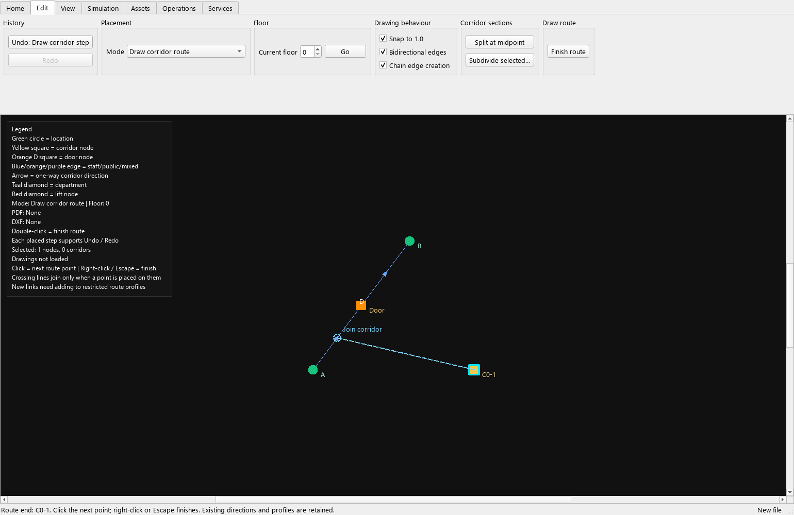

# Continuous corridor drawing — review checkpoint

The **Draw corridor route** mode combines node placement, connection and joining
existing corridors. A dashed preview and text label show whether the next click
will reuse a point, join a corridor or place a node. This is graph editing;
turning radii, lanes and swept-footprint paths remain separate roadmap work.

## Draw and verify a route

1. Open a copy of a project. In **Edit → Placement → Mode**, select
   **Draw corridor route**. Choose the floor and whether new links should be
   bidirectional. Set **Snap to 1.0** for a one-metre grid.
2. Click an existing point or a free position to start. Each following click
   places or reuses a node and connects it to the previous point.
3. Move the pointer near an existing corridor. **Join corridor** appears in the
   preview. Clicking splits that edge, updates its route/resource references and
   connects the new branch in one undoable operation.
4. Finish with right-click, Escape, double-click, or **Finish route**. Placed
   segments remain. The next click starts a separate route.
5. Undo removes the last completed click, including any split, added link and
   changed references. Redo restores it. After undo/redo, click a retained endpoint
   to start drawing from it again. Switching floor, mode or project ends the chain.
6. Review widths and route profiles, run project checks, then simulate.
   The saved `verification/scenarios/corridor-drawn-one-way.json` example should
   complete one task in 9 seconds, with no reverse B-to-A path. Arrowheads show
   each one-way link's direction in the layout.

The **Chain edge creation** checkbox controls the older **Connect corridor**
tool. **Draw corridor route** always continues until finished. It starts new
links with the building's default corridor width and no people classification.
Use existing corridor settings to change these attributes afterwards.

## Snapping and permissions

Point snapping has priority within 0.45 m, followed by projection onto the nearest
explicit corridor within 0.45 m. Otherwise the free point follows the grid;
with grid snapping off, free coordinates retain millimetre precision. A rounded
point that lands exactly on an existing point or corridor joins it. The preview
and committed edit use the same target calculation. Generated automatic graph
connections are not drawing targets until made explicit.

Existing directions, door endpoints, widths and route/resource references survive
a join. Drawing along an existing link reuses it without duplicating it or
changing its direction. **Bidirectional edges** applies only to newly created
links. For one-way links, travel runs from the preceding point to the clicked
point. The older Connect corridor tool now follows the same rule.

Clean, dirty and shared access remains defined by route profiles. Joining a
restricted corridor replaces its permitted edge with the permitted chain, but
does **not** grant the new branch access to that profile. Add the branch explicitly
to each intended profile. An empty allowance still has its existing unrestricted
meaning.

Crossing a line does not create a junction automatically. Place a point on the
intended corridor to join it. If several corridors overlap, the nearest target
is selected deterministically; this operation does not merge every crossing edge.
Use separate visible junctions until a dedicated crossing-junction editor exists.
Subdivision can change traffic reservations and people-occupancy timing; rerun
checks and simulations after editing.

## Independent acceptance evidence

The reference route runs from A=(0,0), through a newly drawn point at (3,4), to
B=(6,8). Its two 3–4–5 sections total 10 m. At 2 m/s with 2 s loading and 2 s
unloading, the expected task duration is **9 seconds**. A one-way connection has
a forward route and no reverse route. Tests verify both against the simulator.

`tests/test_corridor_drawing.py` covers 17 cases: independent timing and direction,
grid/point/edge snapping, collision-free names, branch permissions, existing-link
reuse, atomic failure, invalid/cross-floor links, explicit crossings, grouped
undo/redo, preview purity, finish/reset behaviour and the existing Connect tool.
`tests/test_corridor_editing.py` continues to cover reference rewrites and doors.

**D052:** the previous Connect tool always wrote `bidirectional: true`, even when
the checkbox was unchecked. The reproducing UI test fails against the previous
committed click handler; its output is saved in
`baseline/corridor-direction-before-fix.txt`. New connections now store the chosen
direction. Existing projects are not reinterpreted or migrated automatically;
review historical links if they were intended to be one-way. This deliberately
changes results only when users create links using the corrected tool.

The full roadmap remains open. Remaining editing work includes configurable
snapping tolerances, crossing-junction operations, broader contextual properties
and accessibility review. This checkpoint does not establish geometric traffic
or close the full verification gate.

## Recorded results

The final source passes **699/699 tests**, with **zero broken evidence links**.
The drawn reference completes **1 task, 0 failed, 0 pending**, matching the
independent 9-second calculation. Saved-project checks, execution and event/summary
reconciliation also pass; evidence is in `latest/corridor-drawing-final-reference/`.

The six-hour LTN regression remains **204 completed, 0 failed, 0 pending**, with
unchanged detailed outcome fingerprint
`9140519eb512a425fb5956e26456743bd71bb15594f75ebd430bd3b82095119a`.
Its measured runtime was **14.080 seconds**, not a performance acceptance threshold.
See `latest/ltn-corridor-drawing-final/` and `latest/index.html`.
Both source inputs remain unchanged. LTN retains its existing geometry; this
comparison checks for unintended changes to saved projects.

The actual Qt editor was rendered with the Windows Segoe UI font. Review caught
and corrected ribbon clipping; the final mode selector and dropdown fit inside
their group, and the dashed join preview and one-way arrowheads are visible.
