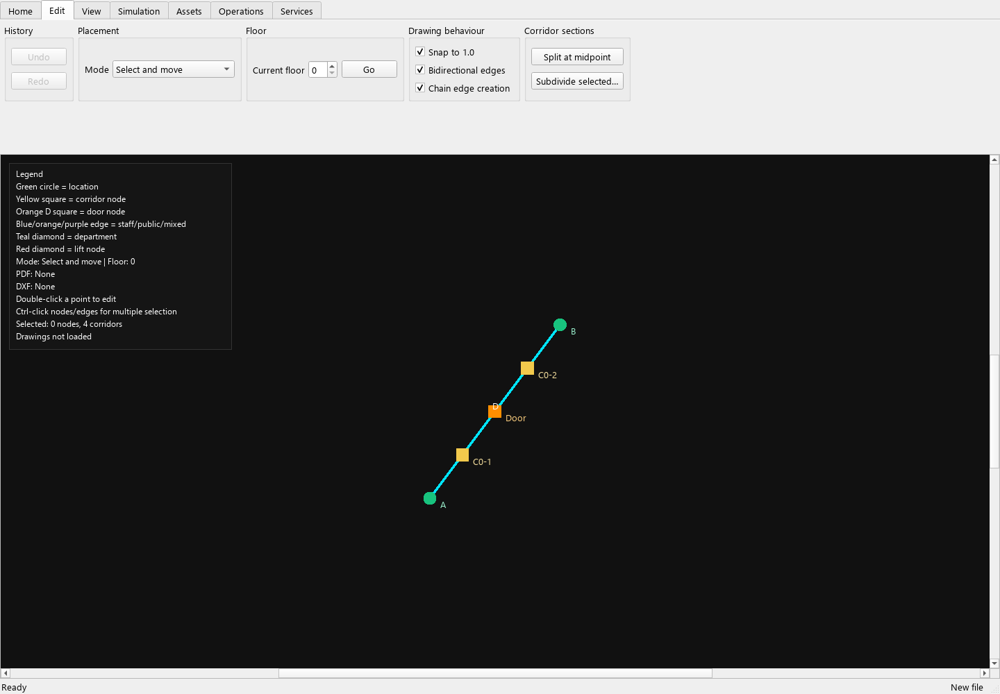

# Corridor splitting and subdivision — review checkpoint

Existing explicit corridor links can now be divided without manually deleting
and rebuilding their connections. Clean, dirty and shared access continues to
use route profiles; no separate route classification has been introduced.

## Try the workflow

1. Open a copy of `verification/scenarios/door-pass.json` in the layout editor.
2. Select an edge in **Select and move** mode. In the **Edit** ribbon, choose
   **Split at midpoint**. One new corridor node appears between its endpoints.
3. Select several edges using Ctrl or Shift, then choose **Subdivide selected…**.
   Enter the number of sections per edge (2–100). A three-section division adds
   two nodes per selected physical corridor, even if both directions were stored.
4. Use **Undo** once. All original edges, nodes and affected route/resource
   references must return together. **Redo** restores the subdivision.
5. In **Corridor node** mode, click near an existing edge. The inserted node is
   projected onto that edge, preserving its line, even when grid snap is enabled.
   Clicking within 0.45 m of an existing endpoint reuses it instead of duplicating it.
   Short sections can also be split using the midpoint or subdivision buttons.
6. Right-click a selected edge to find **Insert node here**, midpoint and
   subdivision actions. Cancelling the subdivision dialog changes nothing.
7. Open `verification/scenarios/corridor-subdivided.json`. This saved example has
   four sections, the original door and an explicit clean profile. Simulate it:
   expect **one completed task, zero failures, 9 seconds**.

## What the operation preserves

The original 10 m route still measures 10 m. At 2 m/s with 2 s each to load and
unload, the independent expectation is **2 + 10 / 2 + 2 = 9 seconds**. Another
acceptance case divides an explicit 20 m distance and expects **14 seconds**.
An explicit zero distance remains zero; absent distance fields remain geometric.

Separate directed edge records retain their own directions, distances, widths,
people attributes and additional metadata. Both directions share the inserted
nodes. Names avoid existing locations and nodes. Existing endpoint doors remain
unchanged; inserted nodes are not doors. A 0.8 m payload still passes the 0.8 m
reference opening, whereas 0.80001 m remains blocked.

Directed `allowed_edges` entries expand into the corresponding directed chain.
Restricted node lists include the inserted nodes when both endpoints were allowed,
including the effective union of a task's local list and its route profile.
Empty lists keep their existing unrestricted meaning. Return profiles are updated
as profiles; outbound local allowances are not treated as inherited return rules.
Clean and dirty reference paths still measure 10 m and 14 m, including their
shared section, and cannot silently use the unrestricted shortcut.

People profiles' explicit corridor lists and scenario corridor resources expand
to every new section. Resource schedules and other attributes are retained.
Invalid subdivision requests reject the complete edit, including bulk selections;
no partial layout or reference changes are committed.

## Scope and evidence

`tests/test_corridor_editing.py` provides 20 acceptance tests covering calculated
geometry/timing, directed attributes, route allowances, loaded door clearance,
people and outage applicability, invalid inputs, naming, cancellation and complete
undo/redo restoration. The full test results are in `latest/index.html`.

The full pack passes **682/682 tests**, with **zero broken evidence links**.
The saved reference also passes through project save, checks, execution and
results reconciliation: **1 completed, 0 failed, 0 pending**, taking 9 simulated
seconds. Both the reference and LTN source inputs remain unchanged.

The six-hour LTN regression produces **204 completed, 0 failed, 0 pending**,
with unchanged detailed outcome fingerprint
`9140519eb512a425fb5956e26456743bd71bb15594f75ebd430bd3b82095119a`.
Runtime was **14.160 seconds** on this machine, an observation rather than a
performance threshold. Evidence is in `latest/corridor-subdivision-reference/`
and `latest/ltn-corridor-editing/`. LTN was not subdivided for this regression;
the comparison checks for unintended changes to existing projects.

Subdivision changes the graph's reservation units. Traffic contention, people
occupancy durations and scenario admission timing can consequently change;
preserving references does not promise identical congested simulation outcomes.
Review the revised layout and rerun project checks and simulations. Drawings
remain underlays; this feature does not establish swept geometry or turning radii.

Only explicit same-floor edges can be subdivided. Automatic graph connections
must first be represented explicitly. Continuous drawing, broader snapping and
automatic linking, previews for other bulk edits, and exhaustive generated-rule
interaction coverage remain open in [ROADMAP.md](ROADMAP.md).
