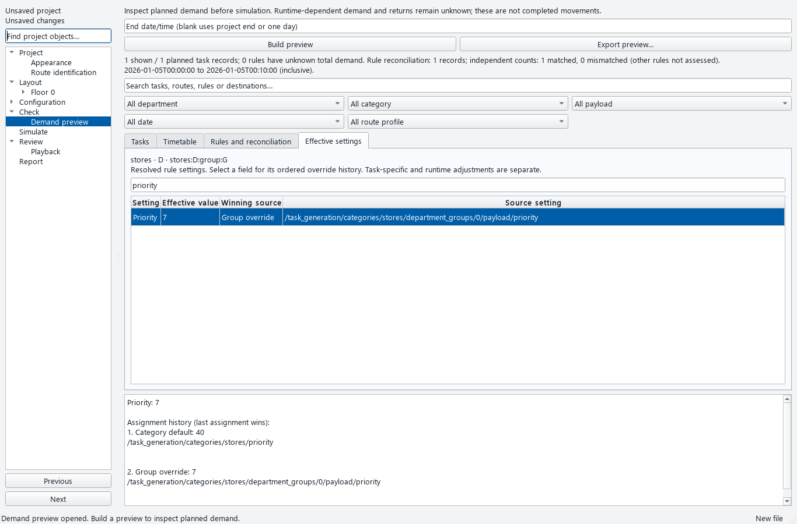
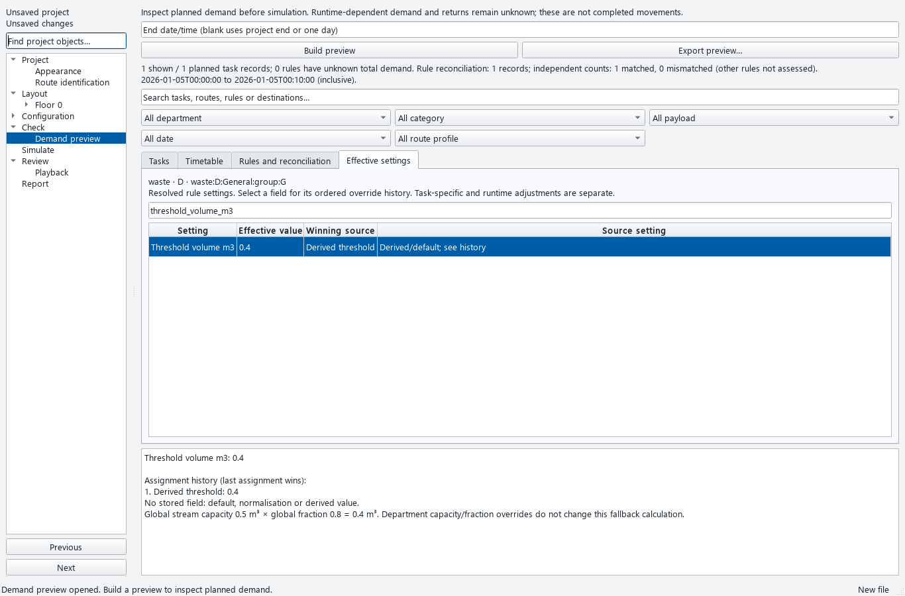

# Demand preview — effective rule settings

Demand preview now records the assignments made while the generator resolves
category, group, department and waste-stream settings. Equal-value overrides
retain their source; matching values are not used to guess inheritance.

## Review this checkpoint

1. Open Check → Demand preview and build a preview.
2. Select a task, or select a row in Rules and reconciliation.
3. Open **Effective settings**. Search for a field, value or source.
4. Select a field to see its ordered assignments. The final assignment determines
   its resolved value. Source paths identify stored fields; calculations and
   defaults explain why there is no direct stored field.
5. Edit a project setting. The existing preview is marked stale and export is
   blocked until it is rebuilt. Filtering tasks clears the previously selected
   rule to avoid displaying an unrelated history.

The reference category priority is 40 and its group override is 7. One task is
planned at 60 seconds with priority 7. Category-wide drop-off capacity policy is
restored after ordinary group/department overrides. Missing category policy uses
the generator default, `allow_temporary_overflow`.

## Waste settings and calculations

Waste payload/container defaults are applied from the global stream, then values
from the department's stream assignment. The preview records both source paths,
including the original array indices. Derived thresholds, event volumes, stream
identities, container grouping and normalisation have separate explanations.

Two behaviours recorded at this checkpoint require careful interpretation. The
global-only threshold calculation below was subsequently corrected in
[checkpoint 2N](WASTE_CONSERVATION_REVIEW.md); the image above is historical.

- A positive configured threshold is retained. Otherwise the fallback uses the
  **global** stream capacity × global fraction (fraction default 0.8). The reference
  calculation is 0.5 m³ × 0.8 = 0.4 m³. A department capacity of 2 m³ and fraction
  of 0.5 do not change that fallback to 1 m³. Set the threshold explicitly when
  needed. This checkpoint explains the existing calculation; it does not change it.
- Department waste-stream values are applied after category-wide policy restoration.
  They can override that policy even though ordinary group/department overrides
  cannot. This exception is covered by a reference test and remains an operating
  policy limitation for further review.

## Evidence and limits

`test_generation_provenance.py` adds 19 acceptance cases: independent precedence
values, equal-value overrides, escaped identifiers, category-only rules, forced
zone handoff, global/department waste sources, derived arithmetic, unknown runtime
totals, non-mutation, older metadata, stale selections and 24 pt desktop sizing.
Actual application screens were inspected at 1366 × 900; 24 pt sizing is tested at
1280 × 800. Demand action/filter rows now accommodate large text.

A comparison with baseline `226c245` used eight generation modes and polls at
60, 600 and 3,600 seconds. Resolved configurations and generated records were
identical. Runtime-driven modes produced no records in these small fixtures;
this comparison does not prove their full behaviour. Local evidence is saved in
`latest/generation-provenance-review.json`.

The LTN preview took approximately 0.54 seconds locally and contained 1,234 planned
records, 264 rules with field histories and 190 rules with unknown total demand.
Every resolved field in those 264 rules had recorded provenance. LTN has no
independently assessed count in this preview; record accounting is not independent
demand validation. Its file checksum remained unchanged.

The export retains schema-1 fields and adds `provenance_schema_version: 1` and
per-rule `field_provenance`. Runtime-dependent totals remain unknown. Histories
cover resolved dynamic rule settings, not every task-specific adjustment, implicit
default used later by the generator, global staff calculation or runtime decision.
Explicit tasks, inactive rules and older previews show history unavailable instead
of invented provenance. Complete zero-work diagnostics, all generation modes and
the broader roadmap remain open.
