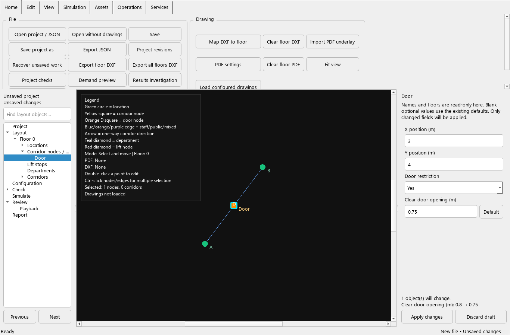
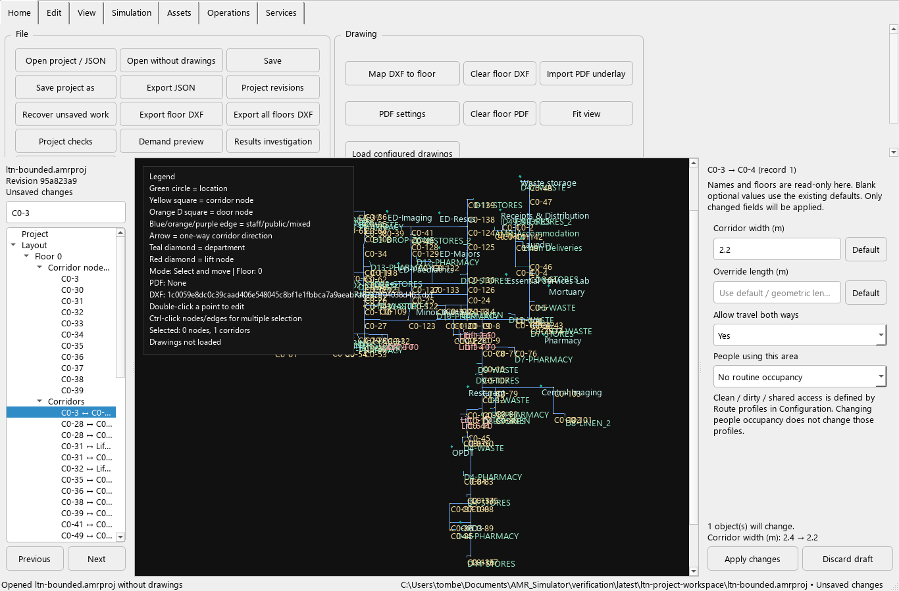

# Layout tree and contextual properties — review checkpoint

The Layout workspace now lists locations, corridor nodes/doors, lift stops,
department markers and individual corridor records beneath each floor. Selecting
an object in the tree selects it on the map and opens its properties on the right.
Use **Find layout objects** to filter names without hiding the workflow stages.

## Try this checkpoint

1. Open a project and expand **Layout → Floor → Corridor nodes / doors**.
   Select a door, or click it on the map.
2. Change its clear opening width. The inline preview shows the old/new values
   and how many objects will change. The project is marked unsaved, but the draft
   does not affect checks or simulation until applied.
3. Choose **Apply changes**. **Undo** restores the complete prior configuration;
   **Redo** reapplies it. Project checks become stale when effective inputs change.
4. Select a corridor record in the tree. Edit width, optional distance override,
   travel direction or people occupancy. Record numbers distinguish separately
   configured directions between the same endpoints.
5. Ctrl-select corridors on the map for bulk width, distance or people-occupancy
   changes. Unchanged/mixed fields retain their original values. **Default**
   explicitly removes an optional numeric override from every selected record.
6. Select another object before applying a draft. The properties panel retains
   the original target and explains this. Apply or discard that draft before
   editing the new selection. A newer edit elsewhere makes the draft stale;
   discard it to reload current values instead of overwriting that edit.
7. Save, export JSON, or close/open a project. Valid pending values are applied
   before the normal save/unsaved-change flow. Invalid values keep the action
   blocked with an inline explanation. No validation popup is needed.

## Supported edits and interpretation

| Object | Properties available here |
| --- | --- |
| Location | X/Y in metres; people occupancy; required wash cycle, duration in seconds and wash location |
| Corridor node / door | X/Y; door enabled; clear opening in metres |
| Lift stop | X/Y for that stop, preserving other floors |
| Department marker | X/Y, preserving department identity and references |
| One explicit corridor record | Width, distance override, two-way permission and people occupancy |
| Multiple corridor records | Width, distance override and people occupancy; individual direction settings remain unchanged |
| Multiple corridor nodes | Door enabled and clear opening |
| Multiple locations | People occupancy and wash settings |

Names and floor assignments remain read-only here. References and route profiles
are preserved because these edits do not rename or recreate the objects. Relative
boundary coordinates remain relative when their location moves. Existing legacy
absolute boundary coordinates retain their original absolute positions.

Blank optional values remove the explicit setting. Tooltips state the fallback:
building corridor/door width, geometric distance, two-way permission, 300-second
wash duration, or the location itself for washing. **Zero distance is an explicit
zero-length override**, not geometric distance; zero wash duration is zero delay.
Widths below the simulator's 0.1 m minimum, negative distances/durations and
non-finite positions are rejected rather than silently accepted by this panel.

Changing a single record to one-way does not remove a separate reverse record.
The tree shows each record's direction. A map selection covers all explicit
records on the selected physical corridor. Automatically generated connections
must first be made explicit before they can be edited here.

People occupancy is distinct from clean/dirty/shared access. Those access rules
continue to be defined by **Route profiles** in Configuration.

## Verification and recovery

`tests/test_layout_properties.py` adds 26 acceptance cases. The reference path
contains two 5 m edges, traversed at 2 m/s with 2 s loading and 2 s unloading.
Replacing the first edge's distance with 10 m gives **11.5 seconds**; replacing it
with zero gives **6.5 seconds**. Removing an override restores the geometric
10 m route. A 0.69 m door blocks a 0.7 m loaded footprint; a one-way record blocks
the corresponding reverse route. These checks use the simulator, independently
calculated expectations and unchanged reference inputs.

Other cases cover target identity, preservation of unrelated fields/profiles,
atomic rejection, one-step undo/redo, stale checks, bulk previews, mixed values,
save/export safeguards, tree search, active-editor conflicts and desktop sizing.
Existing JSON nulls are displayed explicitly and preserved until edited; they
are not presented as missing overrides with potentially different defaults.
Valid unapplied property values are included in the existing recovery snapshot
without committing them to the open model. Invalid/stale drafts preserve the prior
recovery copy and report failure; correct or discard them before relying on a new
recovery copy.

The real LTN object tree contains 2,326 items including groups. Twenty unchanged
refreshes averaged approximately **0.010 seconds** here. This is a local observation,
not a performance acceptance gate. Screenshots use the actual application theme
at 1366 × 900; an automated case checks 1280 × 800.

## Remaining work

Configuration objects such as robots, payloads, schedules and complete route-profile
definitions still use existing dialogs. Full identity-renaming/migration coverage,
floor reassignment, generated-connection editing, broad accessibility controls,
route labels/patterns, and all geometric-traffic requirements remain open. The
verification pack and wider roadmap are not complete simply because this checkpoint
passes its acceptance tests.
