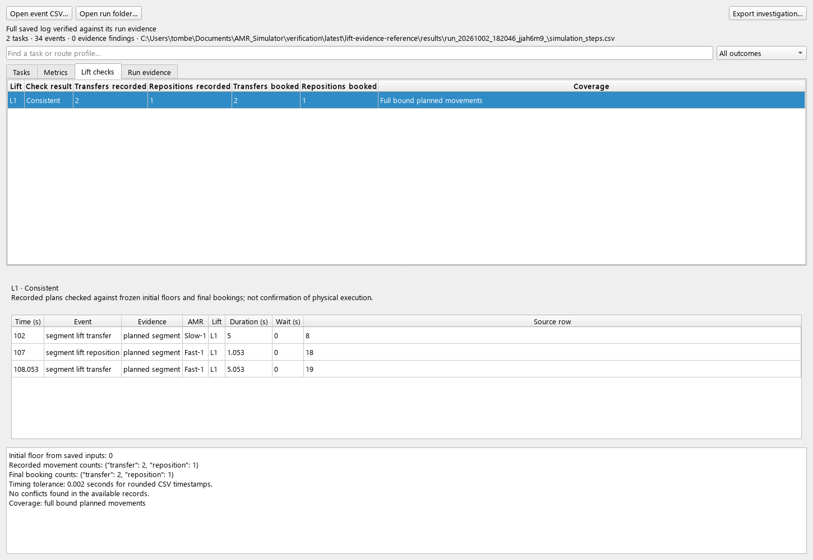
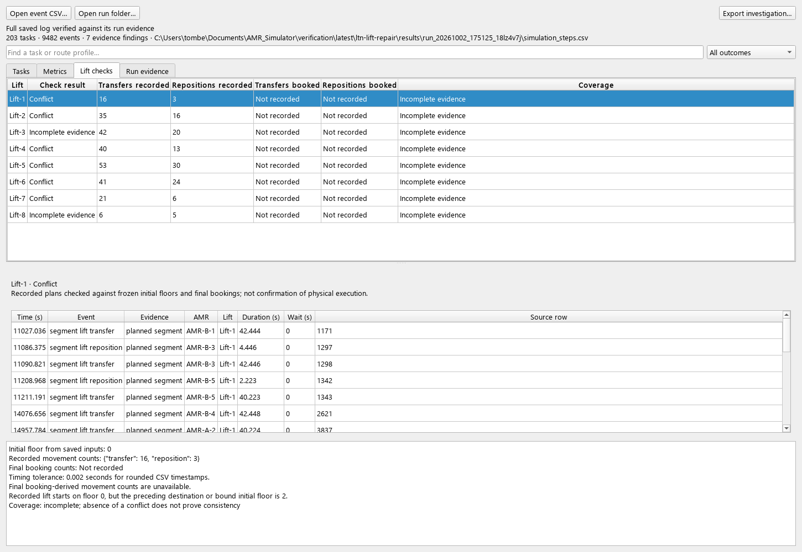

# Investigating lift movement consistency

Results Investigation now includes **Lift checks**. It audits recorded plans
using the run's saved inputs and booking counts; it never reads the current
editor layout to reconstruct a past result.

**D051** also fixes an existing investigation defect: iterating energy sources
overwrote the original log path with `lift_supply`, affecting the header and
exported investigation. The original file path is now retained. Its reproducing
test and before-fix result are recorded in `baseline/investigation-source-before.txt`.

## Review in the application

1. Run `scenarios/lift-reservation-order.json` with full event logging enabled.
2. Open its saved run folder in Results Investigation and select **Lift checks**.
3. L1 should show **Consistent**, with **2 transfers** and **1 reposition** in
   both the recorded and booked columns, and **Full bound planned movements**.
4. Select L1. Its three movement records appear in the timeline. Select a record
   to inspect its original row, event identity and recorded details.
5. In **Metrics**, select the lift floor-change, overlap or count-mismatch metric.
   A conflict links to its supporting event records. A verified reference shows
   zero for each. Older or filtered evidence shows **Not recorded** when an
   observed zero cannot be established for the full run.

The historical LTN log below retains observed conflicts while clearly showing
that final booking counts were not recorded by that version:

## What is checked

- **Floor continuity:** the first recorded origin matches the initial lift floor
  in the saved inputs; each subsequent non-overlapping movement starts where the
  previous one ended. Negative floors are supported. Empty reposition endpoints
  come from explicit lift node names, not the waiting robot's coordinates.
- **Exclusive use:** a movement cannot start while an earlier movement of the
  same lift still occupies it. Distinct lifts can move simultaneously. The check
  tolerates 0.002 seconds for rounded CSV start and duration values. A nested
  conflict remains detectable even when another shorter overlapping interval ends.
  Each conflicting start counts once; this is not the number of all overlapping
  interval pairs.
- **Booking reconciliation:** new run sidecars contain transfer and reposition
  counts derived from committed lift reservations, independently of event rows.
  These must match the recorded movement counts for each configured lift. A
  missing movement can therefore be detected even when the surviving rows are
  internally continuous. Shared task lists do not multiply movements. Repeated
  native event IDs count once; conflicting duplicate IDs are rejected by the
  existing investigation reader.

## Interpreting the result

**Consistent** requires a complete, finished, checksum-bound full log, native
event identities, the new booking-count capability, valid initial-floor inputs,
valid movement endpoints/times, matching counts and no detected conflict.
An unused lift can have a verified zero when those conditions are met.

**Conflict** identifies a contradictory observed sequence, overlapping plans or
a booking/log count mismatch. Select the lift or metric to inspect the related
records. Coverage is shown separately: an observed floor gap in a partial log may
reflect omitted movements, so it does not by itself prove a simulator defect.

**Incomplete evidence** means the available data cannot establish consistency.
Examples include older logs without final counts, playback/reduced logs,
cancelled runs, missing lift identities, malformed movement times and missing
reposition endpoints. The checker does not bridge malformed movements, infer
missing travel or substitute robot locations for lift locations. Older logs still
show usable observations and stable legacy row links.

Zero-duration vertical travel cannot be verified from rounded event evidence.
There is no silent geometric or temporal reconstruction. Movement records remain
**planned segments**, not independent confirmation of physical execution.

## Acceptance evidence and remaining work

The full verification suite passes **647/647 tests**, with **zero broken evidence
links**. Eighteen new acceptance tests cover the lift evidence feature and D051.
The saved reference has **2 completed tasks**, **0 failed**, **0 pending**, and
verified counts of two transfers and one reposition.

The fresh LTN run has **204 completed tasks**, **0 failed** and **0 pending**. All
eight lifts have complete coverage and matching counts: **255 transfers + 113
empty repositions = 368 planned movements**, with no detected floor, overlap or
count conflict. The detailed outcome fingerprint remains
`9140519eb512a425fb5956e26456743bd71bb15594f75ebd430bd3b82095119a`.
Observed runtime was **14.372 seconds**; this is not a performance threshold.
Both input files remain unchanged. Generated evidence is in
`latest/lift-evidence-reference/` and `latest/ltn-lift-evidence/`, with test evidence
in `latest/index.html`.

Re-reading the earlier `ltn-lift-repair` log detects the same **nine observed
floor discontinuities** found by the independent D049/D050 audit. Its absent
booking counts correctly prevent full verified coverage; no historical log or
sidecar was rewritten. The two illustrated screens were visually inspected.

`tests/test_lift_evidence.py` covers continuous/negative-floor sequences,
first/subsequent discontinuities, nested overlaps, exact and rounded boundaries,
independent lifts, malformed and legacy records, missing/conflicting endpoints,
missing/count-mismatched summaries, real simulator exports and UI event links.
A controlled missing-row fixture retains original booking counts while binding
the modified log, so it tests semantic reconciliation rather than merely checksum
rejection. The original saved project is never modified by this fixture.

These checks do not prove lift door clearance, swept geometry, mid-journey failure
handling, repair timing, stochastic reliability, continuous cabin occupancy or
all PDF report totals. Large-log pagination and the remaining investigation
requirements stay open in [ROADMAP.md](ROADMAP.md).
