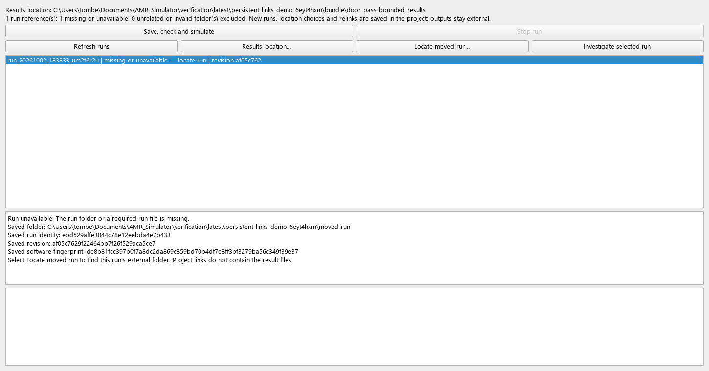
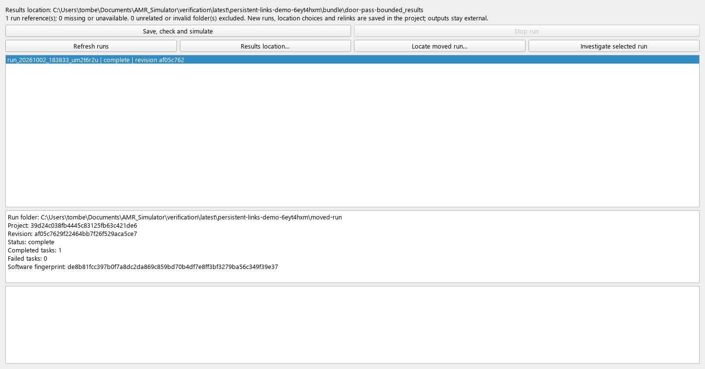

# Persistent external results — review checkpoint

New project runs, custom results locations and relinked run folders are now saved
in the `.amrproj` manifest. Results remain external: the archive contains only
small run references, configuration revisions and deduplicated drawings.

## Review the workflow

1. Open a copy of a reference project and choose **Project runs**. Use **Results
   location…** to select a folder. Close and reopen the project; the location
   should remain selected.
2. Choose **Save, check and simulate**. Once checks are accepted, the run reference
   is saved before the subprocess starts. Reopen the project and check that the
   run is listed against its original revision.
3. Close the application and move that run folder elsewhere. Reopen the project.
   The old entry remains visible as **missing or unavailable**. Select it to see
   the saved run/revision/software identity.
4. Select **Locate moved run…** and choose the moved folder. Its frozen inputs and
   checks must validate, and its run, revision and software identities must match
   the selected reference. A different run from the same project is rejected.
5. Reopen again. The corrected location should persist. Investigate the run using
   its own saved inputs and events.
6. Make an unsaved configuration edit, then change the results location or relink
   another run. The configuration must remain unsaved; reopening the saved project
   must show the previous saved configuration. Only results metadata was saved.

For an existing run that predates persistent references, **Locate moved run…**
with no selected entry can attach any verified run belonging to a saved revision
of this project. Existing folders under the selected results root are still
discovered without changing the archive merely by refreshing the list.

## Moving and saving projects

Locations on the same drive use paths relative to the project file, including
parent-directory references where necessary. Move the project and results with
their relative folder arrangement intact to preserve the links automatically.
Cross-drive locations use absolute paths and may need relinking on another PC.

**Save As** preserves the existing external folders and rebases stored paths to
the new project location. It does not copy or move result files. A default results
root without an explicit preference follows the new project filename; remembered
older runs still retain their references. A copied project retains its project
identity and revision history, as before.

Run references survive configuration saves and revision restores. Updating a
results location or link does not create a configuration revision. It also does
not rewrite frozen run inputs, old logs or the run's original software identity.
Repeating the same relink is idempotent.

## Storage and compatibility

The version-1 archive gains optional `external_results` metadata with its own
version. Each entry stores a run ID, saved revision ID/configuration checksum,
software checksum, display name and location. No result CSV, report or log is
embedded. Missing or inaccessible result folders do not prevent the project
from opening. An available folder with changed identity is shown as unavailable,
not silently substituted.

Older archives without this metadata open with an empty reference list and the
usual default results folder. Opening does not rewrite them; an explicit metadata
change or accepted new run adds the extension through an atomic save. Unknown
metadata versions and malformed references are rejected without rewriting the
archive. Older application builds that do not understand the extension may drop
it on resave; use this build when maintaining persistent links. Full cross-version
migration coverage remains a separate roadmap requirement.

Archive updates retain the existing atomic replacement and external-change
checks. Failed writes preserve both saved bytes and in-memory references. A
failed link save prevents starting the new run and its uncommitted draft can be
discarded. Relinking verifies identity and frozen inputs; it does not by itself
certify the run's results or prove a formerly running process is still alive.

## Acceptance coverage and remaining work

The full verification suite passes **662/662 tests**, with **zero broken evidence
links**. Fifteen new acceptance tests exercise persistence and relocation.
The saved door reference completes **one task in 9 seconds**, with no failed or
pending tasks. Reopening its archive confirms **one configuration revision and
one persistent run reference**; the reference occupies **385 bytes before
compression** and the whole small project is **1,245 bytes**. No result CSVs are
embedded. These are fixture measurements, not universal size limits.

The six-hour LTN release window still produces **204 completed tasks, 0 failed
and 0 pending**, with unchanged detailed outcome fingerprint
`9140519eb512a425fb5956e26456743bd71bb15594f75ebd430bd3b82095119a`.
Its archive also reopens with one saved revision and one run reference, and no
embedded simulation outputs. Runtime was **14.385 seconds** on this machine,
an observation rather than a performance threshold. Both input JSON files remain
unchanged. Evidence is in `latest/persistent-run-reference/`,
`latest/ltn-persistent-links/` and `latest/index.html`.

The missing/relinked screens were reviewed using a separate copied bundle. The
original reference results were preserved, and a second archive reopen confirmed
that the demonstration's corrected link persisted.

`tests/test_persistent_run_links.py` covers reopening, custom and absolute roots,
moving a bundle, Save As, relink identity/idempotence, changed software identity,
atomic failure, external project changes, old archives, invalid metadata, revision
restore and preservation of unsaved editor changes. Existing project-run tests
continue to cover checked execution, cancellation, subprocess failures and results
remaining outside the archive.

Storage and directory discovery remain synchronous. Large-project responsiveness,
removal/retention controls, a full persistent project tree and complete format
migrations remain open in [ROADMAP.md](ROADMAP.md).
