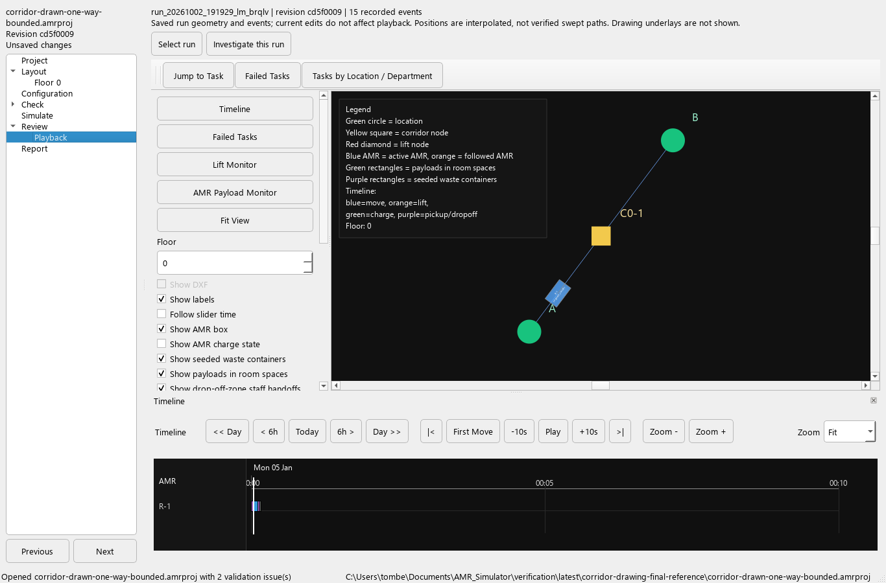
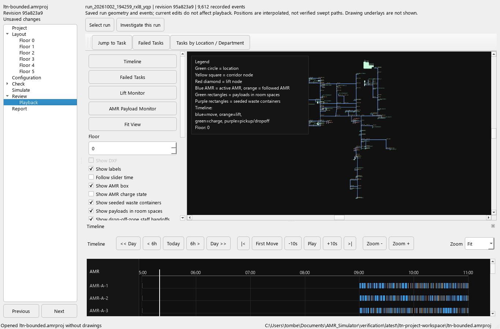

# Project playback — review checkpoint

Completed project runs can now play inside **Review → Playback**. The map,
timeline, task navigation and lift/payload monitors reuse the existing visualiser.
The standalone visualiser remains available with its original file-loading path.

## Try this checkpoint

1. Open a saved `.amrproj`, choose **Simulate**, and select a completed run.
2. Choose **Playback selected run**. The heading identifies the run and event count;
   its tooltip gives the saved revision. Loading and input checks run in a background
   worker. Incomplete, modified or reduced evidence is rejected.
3. Use **Play**, the time slider or a click on the timeline. **Inspect** contains
   **First movement**, **Jump to task** and **Failed tasks**.
   The timeline's **Fit** option fits the simulation window; zoom in to inspect
   short activities. Scroll vertically to see additional robots.
4. Horizontal controls above the map select floor, speed and followed robot.
   **Display** contains visibility options and an optional legend. Drag the divider
   above the timeline to resize the panes. Controls fit at 1280 × 800 and 1024 × 768;
   **Fit** refits the timeline after resizing. Loaded-file text is omitted.
5. Use **Inspect → Lift monitor** or **AMR payload monitor**. Leaving Playback pauses the
   run and closes its auxiliary dialogs. Returning does not restart playback.
6. Choose **Investigate this run** to inspect supporting records, or **Next** to
   report on the played run. A different selection in Simulate does not silently
   substitute another run for the report.
7. Make an unsaved layout/configuration change and return to Playback. The run
   still uses its original geometry and inputs. Opening another project clears
   playback. A late worker completion cannot restore the previous project's run.





## Independent checks and evidence

The October 9 layout/performance update caches only the visible timeline background,
indexes blocks by time and draws only visible lanes. Playhead movement repaints the
old/new cursor strips; scrolling, zooming, resizing, font changes and replacement
data refresh the cache. Drag-to-seek work is coalesced at 33 ms, with final position
applied on release and pending work cancelled when leaving playback. Floor and label
changes reuse the frozen timeline data. Partial-run cutoffs remain enforced.

Three timeline regressions cover cache reuse/invalidation, viewport-bounded memory,
time culling, long overlapping blocks and instantaneous events. Two additional
playback cases cover retained display controls and coalesced seeks with independently
calculated positions. A local synthetic benchmark with 24,000 blocks measured about
130 ms per redraw with the original widget and 0.05 ms with the warmed viewport cache.
This measures timeline painting, not overall playback frame time or loading speed.

`tests/test_project_playback.py` adds 18 acceptance cases. On the reference path,
the robot loads for 2 seconds, then travels from (0, 0) to (3, 4) at 2 m/s. At
3 seconds it is at **(1.2, 1.6)**; at 4 seconds it is at **(2.4, 3.2)**. Seeking
backwards returns to the same position and retains the native event identity.
The complete task still takes **9 seconds**.

Tests also cover read-only parsing, equivalence with standalone parsing, frozen
configuration isolation, modified evidence, changes during loading, asynchronous
completion, obsolete selections, project/revision identity, desktop layout,
pause/close behaviour, undo availability, and the playback-to-report transition.

The saved six-hour LTN run was also loaded: **9,612 events**, including the local
lift monitor. Loading took approximately **0.4 seconds** in this environment;
initial widget/data setup took approximately **0.1 seconds**. These are observations,
not performance acceptance thresholds. The run's existing 204 completed, zero
failed and zero pending outcomes are unchanged by playback. Timing and source
run details are in `latest/playback-ui-review.json`.

## Boundaries still open

- The integrated path requires a completed project run and full matching event
  evidence. Older or incomplete logs remain accessible through Results
  investigation and the standalone tools; they are not promoted to verified runs.
- Positions interpolate the recorded segment endpoints. Planned segment records
  do not prove actual execution, swept clearance, turn feasibility or lane rules.
  Clean/dirty/shared access continues to be defined by route profiles.
- The map shows model geometry without drawing underlays. Embedded rendering uses
  Qt's raster viewport; the standalone visualiser retains its OpenGL option.
- Configured containers and optional waste-fill estimates are derived displays.
  Waste-fill estimation is off by default and explicitly labelled. Use Results
  investigation for evidence coverage and reconciled physical counts.
- Loading retains an in-memory event index. Obsolete loads finish safely in the
  background and their results are ignored; interruptible loading, paging and a
  representative large-log performance gate remain open. The initial scene and
  timeline are built on the UI thread.
- Contextual properties, fuller object navigation, all accessibility controls,
  verified geometric traffic and the remaining roadmap gates are still open.

Run the acceptance suite with:

```powershell
.venv/Scripts/python.exe -m unittest tests.test_project_playback -v
.venv/Scripts/python.exe -m verification.run --output verification/latest
```
