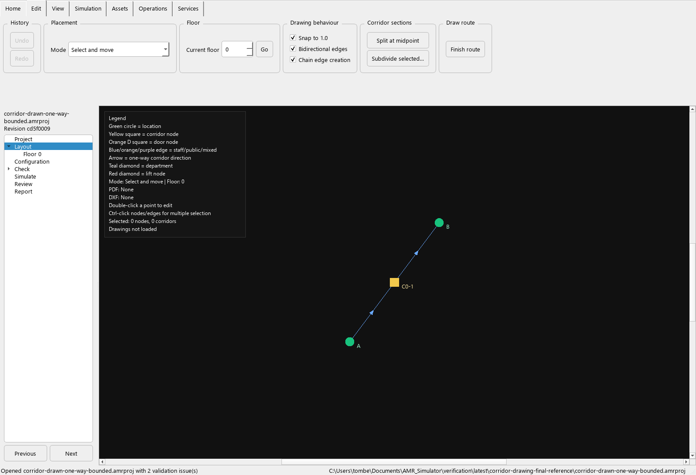
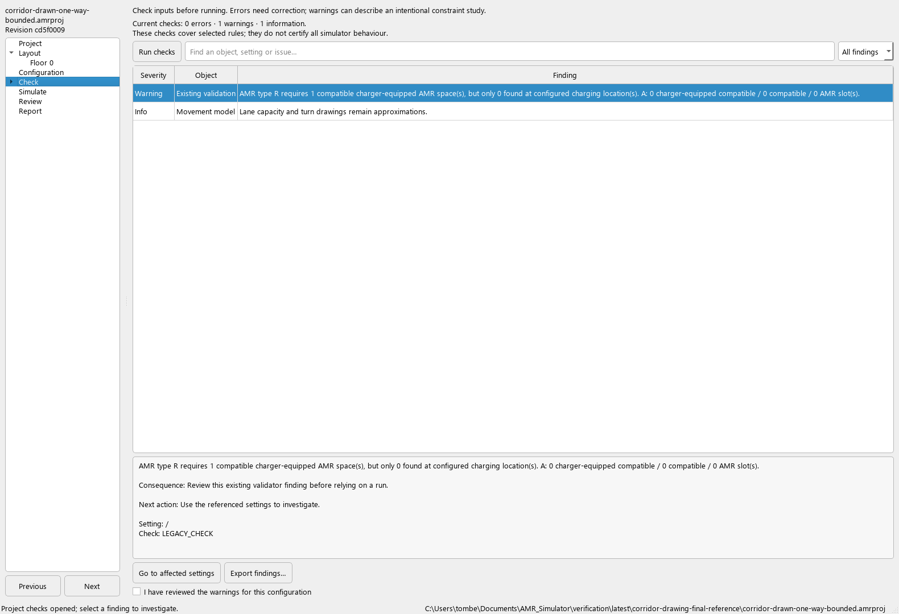
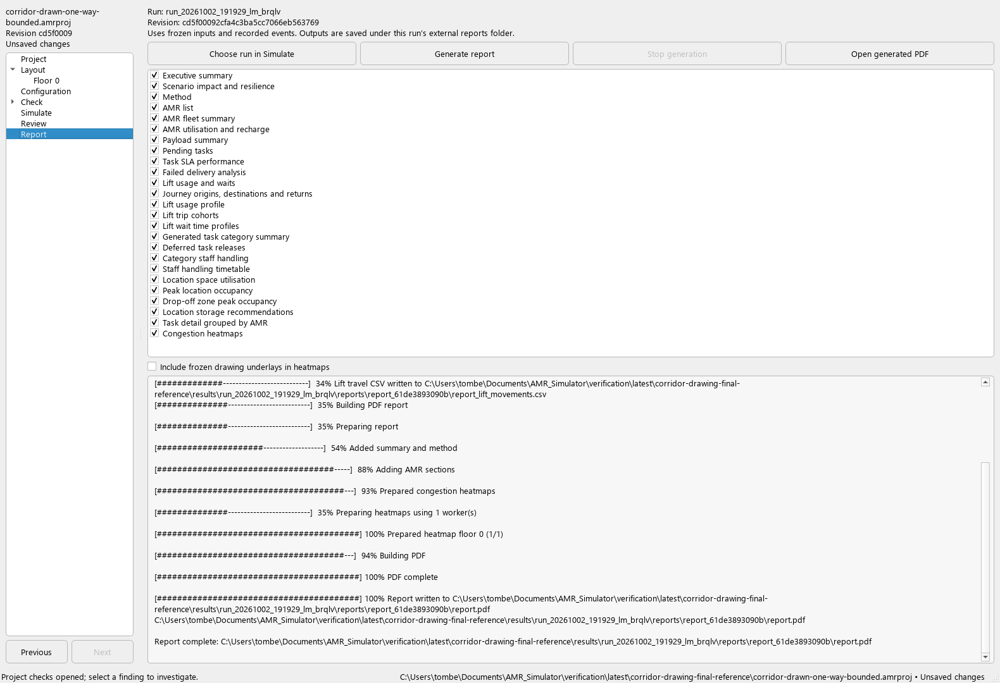

# Unified project workflow — review checkpoint

The application now has a persistent project navigator and one central workspace.
The seven stages use the same editor configuration and saved project. Existing
checks, demand preview, revision history, run management and investigation panels
are retained as central pages instead of accumulating docks around the layout.

## Walk through the project

1. Choose **Project**. Open a JSON or `.amrproj`, save a project, compare revisions,
   restore a revision, export JSON or review recovery copies. The navigator shows
   the current filename, saved revision and unsaved-change status.
2. Choose **Layout**, or a floor beneath it. The existing drawing tools and ribbon
   appear. Changing stages finishes a continuous drawing chain but retains placed
   geometry. Returning to Layout preserves the same canvas and editing history.
3. Choose **Configuration** to access the existing robot, payload, lift, task,
   generation, route-profile, department, people, scenario and corridor editors.
   These still use their existing dialogs and undo behaviour.
4. Choose **Check**. Findings occupy the central workspace; navigating to an
   affected point returns to Layout on the correct floor. **Demand preview** is a
   child of Check. Both read the current configuration and retain staleness checks.
5. Choose **Simulate**. Save, check and run a frozen project revision. Select its
   completed external run. **Next** or **Investigate selected run** opens its
   recorded events in Review. A stage change does not start a simulation.
6. In **Review**, inspect task outcomes, metrics and lift evidence. Existing CSV
   and folder loading remains available. It uses the loaded run's frozen inputs,
   never the current editor configuration. Previously loaded investigation data
   remains visible until another run is opened; check the displayed run identity.
7. Choose **Report selected run** from Simulate, or **Next** from Review with a
   run selected. Select report sections and optionally include frozen drawing
   underlays, then choose **Generate report**. Generation runs separately so the
   application remains responsive. **Open generated PDF** uses the system viewer.

Previous/Next moves through the seven stages. The tree supports normal keyboard
selection. The original command-line tools remain available.

## Reporting and evidence boundaries

Integrated reporting accepts completed project runs with full, matching event
evidence. Missing, modified, reduced or incomplete evidence is rejected. Older
or incomplete logs can still be inspected through Review and the existing tools;
this reporting path does not infer missing events.

Reports are written beneath the selected run's `reports` directory, in a new
folder for each generation. The project archive, frozen configuration and event
CSV are not rewritten. The report configuration is a separate copy; drawing paths
are rebased to that run's copied assets. Current unsaved edits cannot change the
report's model inputs.

`report_manifest.json` records the source run/revision binding, input and log
checksums, simulation software identity, report source-file fingerprint, selected
sections and final PDF checksum. Input records and report code are checked again
after generation. This is reproducible provenance, not a tamper-proof audit.

Stopping generation records cancellation. Failures remain failed; partial files
are not enabled as completed PDFs. Each generation has its own folder, so earlier
reports are not overwritten. Opening another project or closing the application
is blocked while a report runs; stop it or wait for completion first. Layout edits
remain possible during generation because reports use the frozen run.

The existing report calculations and section definitions are reused. Successful
PDF creation does not establish complete metric reconciliation. Reports use the
current report implementation, whose fingerprint is recorded separately from the
simulator version that produced the run.

## Verification scope

`tests/test_project_workspace.py` covers 19 cases: seven-stage navigation, shared
state, undo/check staleness, floor navigation, route finishing, real reference-PDF
generation, subprocess completion, cancellation, source mutation, output overwrite
protection, invalid evidence, section validation, theme integration and preservation of unsaved edits.
Existing project, run, report, checks and investigation acceptance cases continue
to apply. The reference task is 10 m at 2 m/s with 2 s loading and unloading:
**9 seconds**, independent of later edits to robot speed.

**D053:** read-only drawing queries previously inserted missing empty lists into
the configuration. Merely showing the layout could therefore mark a freshly
opened project as unsaved and add an undo step. The reproduced failure is in
`baseline/drawing-read-before-fix.txt`. Queries now leave the configuration alone;
explicit drawing-mapping edits still create the required lists. Simulation
behaviour is unchanged.

Playback is now embedded under Review; see PROJECT_PLAYBACK_REVIEW.md. Adding contextual properties,
expanding the object tree, replacing frequent modal editing, preserving workspace
preferences across application restarts, report browsing/retention and large-file
responsiveness remain open. This checkpoint does not close the full roadmap.

## Recorded results

The final pack passes **718/718 tests**, with **zero broken evidence links**.
The real themed application was exercised through Layout, Check, Simulate and
Report. All report sections generated a **27-page reference PDF**. Its copied
configuration retained the frozen robot speed of **2 m/s**, while the editor had
an unsaved speed of **99 m/s**. Checksums confirm that the project archive, source
configuration and event CSV remained unchanged. The record and external PDF path
are in `latest/workspace-ui-review.json`.

Visual review of the workspace found and corrected the main-window/dialog theme
interaction and navigator visibility. After D053, opening the layout and checking
it also preserve the clean saved state. This visual review covers the application
screens; it does not replace a complete layout/metric audit of every PDF section.

The six-hour LTN reference completes **204 tasks, 0 failed, 0 pending**, with
unchanged detailed outcome fingerprint
`9140519eb512a425fb5956e26456743bd71bb15594f75ebd430bd3b82095119a`.
Measured runtime was **14.188 seconds**, not a performance acceptance threshold.
Its unchanged-input and event/summary reconciliation records are in
`latest/ltn-project-workspace/`; the full test pack is `latest/index.html`.
