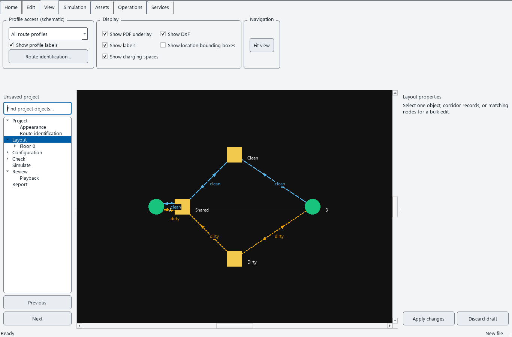
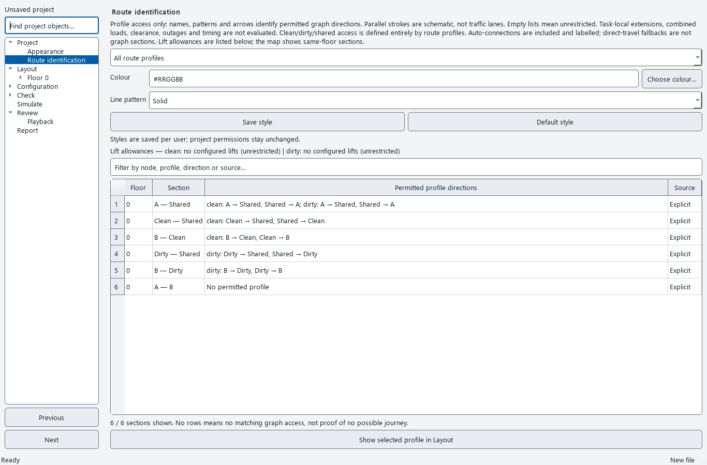
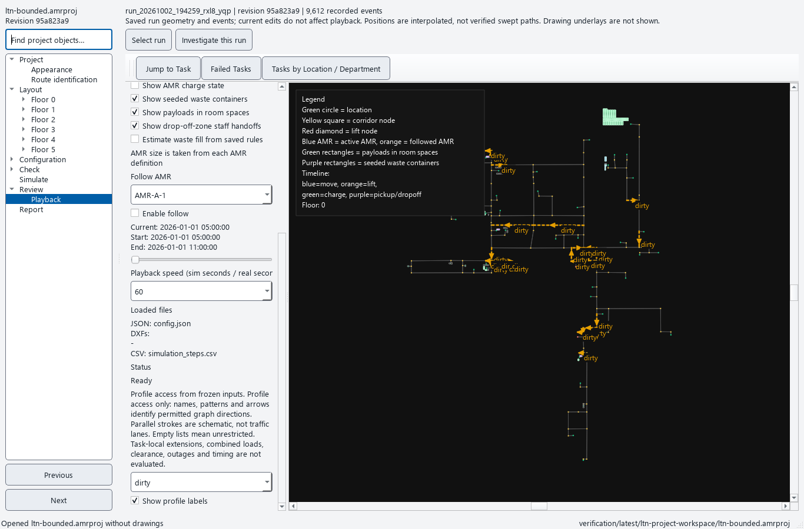
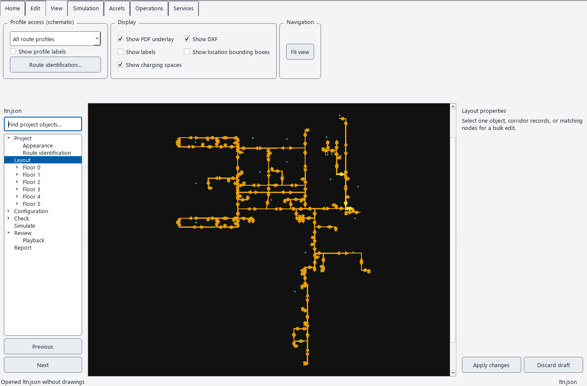

# Route identification — review checkpoint

Route profiles remain the sole definition of clean, dirty and shared access.
The new display gives each profile a name, colour, line pattern and direction
arrows. Shared sections carry every permitted profile's display. No additional
clean/dirty classification is stored in the project.

## Try it

1. Open **Project → Route identification**, or use **Layout → View → Route
   identification…**. Choose a profile or **All route profiles**.
2. Search the table for a node, profile or directed pair. It lists physical
   sections and the permitted directions of each profile. An empty allowance
   list means unrestricted access in that dimension.
3. Select one profile to change its colour and line pattern, then choose **Save
   style**. Styles are per-user preferences, keyed by profile name, shared between
   projects with the same names. **Default style** restores the deterministic
   style. Permissions, undo history, checks and saved run inputs do not change.
4. Choose **Show selected profile in Layout**. The View ribbon also lets you
   switch directly between profiles, all profiles and display off. Hide profile
   labels for crowded maps; hover over lines or labels to inspect named directions.
5. Open a completed run in **Review → Playback**. Scroll to the profile controls
   at the bottom of its left-hand controls. Those choices and their access come
   from that run's frozen configuration, independently of current project edits.

The small illustration uses the clean/dirty reference configuration with display
coordinates spread out for readability. Its explicit edge distances and profile
permissions are unchanged: the shared stem is 2 m, the clean branch adds 8 m, and
the dirty branch adds 12 m. The grey 1 m shortcut is allowed by neither profile.
The resulting loaded-task references remain **9 seconds** and **11 seconds** at
2 m/s with 4 seconds of handling. These values derive from configured distances,
not the illustration's pixel lengths.

## What the display means

- Grey lines are the underlying explicit corridors while profile display is on.
  Coloured/patterned lines show profile-permitted graph sections. Arrowheads show
  permitted directions; allowing A → B does not also permit B → A.
- Node allowances and directed-edge allowances apply together. Physical one-way
  edges still constrain travel. Multiple explicit records are combined for display
  without modifying their independent simulation properties.
- The preview includes automatic location/lift-to-corridor connections. Labels
  and tooltips mark automatic directions; the table distinguishes explicit,
  automatic and mixed-source sections. With auto-connect enabled, a location with
  only an incoming explicit edge can receive an automatic reverse connection.
- Lift allowances are listed separately. A disallowed lift does not prevent
  same-floor transit past its graph node. Vertical lift travel is not drawn as a
  same-floor corridor.
- Parallel strokes are schematic identifiers, **not traffic lanes**. Profile
  access is not proof of a feasible robot journey. Task-local extensions, combined
  onboard restrictions, robot/payload clearance, outages, occupancy, timing and
  geometric manoeuvres are outside this display. Direct-travel fallbacks without
  graph sections are not drawn. No rows is therefore not proof of no possible journey.
- Malformed profile/graph data makes the preview explicitly unavailable. It does
  not silently substitute unrestricted access. Removing a selected profile turns
  its map display off. The normal Project checks remain necessary.

Names have a dark backing for readability over drawings. Custom colours must
meet a 4.5:1 label contrast target against that background. Names still distinguish
profiles if colour or pattern choices coincide. Display mode and label visibility
are window controls; only profile colour/pattern overrides persist, in the same
per-user settings store as Appearance, under `route-display/v1`.

This playback illustration uses the saved LTN run with 9,612 events. The timeline
is collapsed to show more of the map. Frozen configuration checksums remained
unchanged during the review.

## Evidence and remaining work

`tests/test_route_display.py` adds 25 acceptance cases: independently enumerated
clean/dirty/shared directions, agreement with simulator graph restrictions,
one-way/empty/node rules, automatic reverse links and tie ordering, lift transit,
malformed data, task-local scope, stable styles, persistence/reset/write failures,
map labels/arrows/picking, filtering, cache invalidation, deleted-profile behaviour,
display-off cleanup, 24 pt controls, visible invalid-preview notices and frozen
playback inputs.

Actual screens were inspected at 1366 × 900, and large-text sizing at 1280 × 800.
The LTN preview includes 804 physical sections and three profiles. Local timings
and input-integrity checks are recorded in `latest/route-display-ui-review.json`;
they are measurements rather than performance acceptance thresholds.

Dense labels still benefit from zooming or choosing a single profile. Automatic
label collision avoidance and equivalent controls in the standalone legacy viewer
remain open. Geometric lanes, conflict reservations, swept clearance, turning and
manoeuvring are separate roadmap requirements and are not established by this
checkpoint. The broad roadmap gates remain open.
